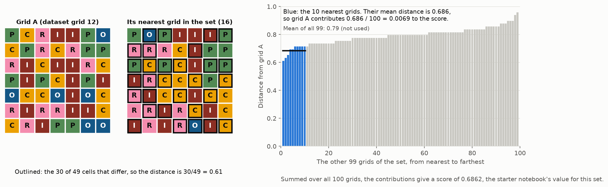
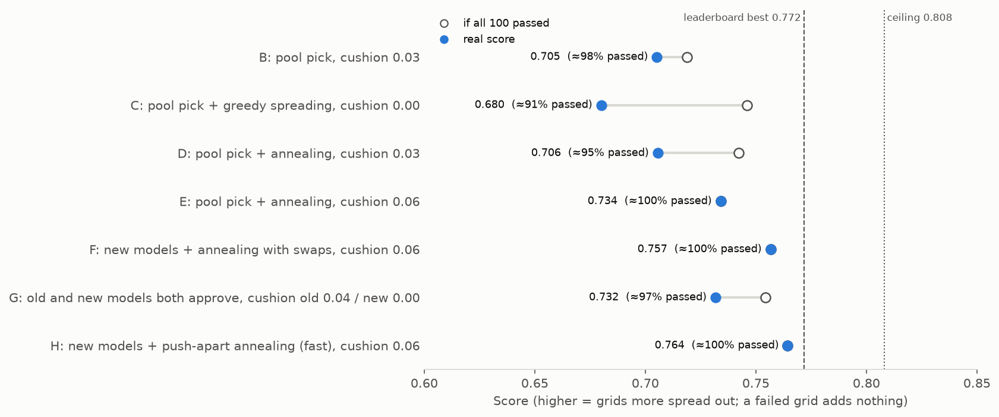
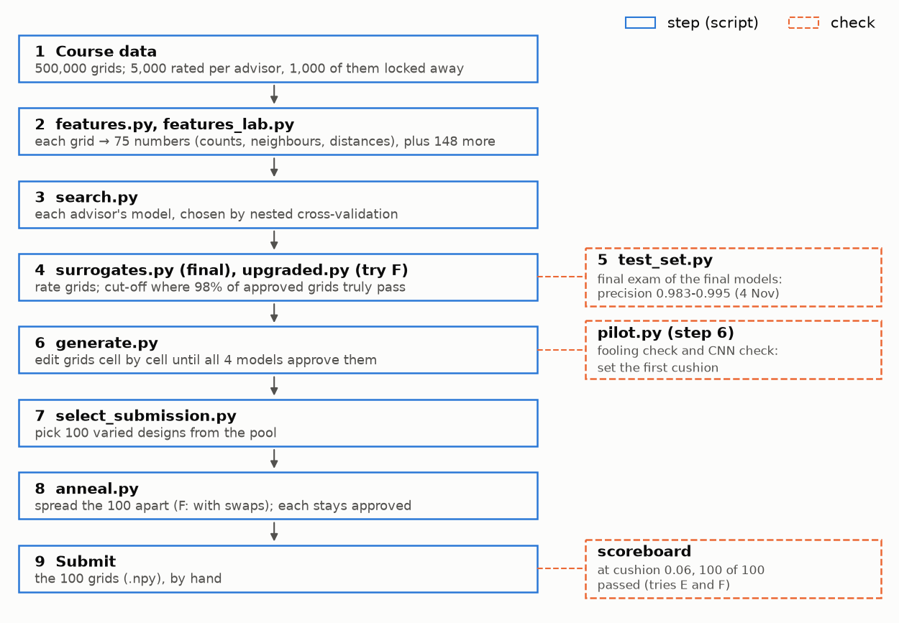

# 2.156 ps2 — Challenge Problem 2: City Zoning

MIT 2.156, Fall 2026 · Fatak Borhani, Joel Pederson, Leif Akerley · due 13 November 2026

**Goal.** Submit 100 city layouts (*grids*: 7 × 7 cells, each one of five districts:
Residential, Industrial, Commercial, Park, Office).
- **Advisors.** Four hidden scoring functions (Wellness, Tax, Transportation, Business) each rate a
  grid 0–1.
- **Valid.** A grid is valid if all four advisors rate it at least 0.75.
- **Score.** Each valid grid adds its mean distance to its 10 nearest valid grids, divided by 100.
  Distance is the fraction of the 49 cells that differ (Figure 1).
- **What we have.** 5,000 example ratings per advisor, and up to 5 scoreboard tries a day.



**Figure 1. The score, worked for one grid.** The example set is the first 100 dataset grids (the
starter notebook's example, score 0.6862).
- **Left:** grid A and its nearest grid in the set. 30 of the 49 cells differ (outlined), so their
  distance is 0.61.
- **Right:** grid A's distances to the other 99 grids. Only the 10 nearest (blue) count: their mean,
  0.686, divided by 100 is grid A's share of the score.

## Where we are



**Figure 2. Our scoreboard tries (7–8 Nov).** The dot is the real score. The open circle is the
score if all 100 grids had passed, so the gap is the failed grids; "≈% passed" is the real score as
a share of that.
- **Labels:** *pool pick*: choose 100 from the design pool (step 7). *Greedy spreading*,
  *annealing*: then push them apart (step 8). *Cushion*: how far above each cut-off every grid must
  be rated. *New models*, *swaps*: try F's upgrades (end of Code flow). G needed both the old and
  the new models to approve every grid.
- **Best:** F, 0.757, with all 100 passing. That was 3rd team on 8 Nov; the leader is at 0.772.
- **Ceiling:** no 100 grids can score above 0.808 (the dotted line).
- Try A was uploaded in the wrong format and not scored.

## Code flow



**Figure 3. The pipeline.** Solid boxes are the steps below, numbered to match. Dashed boxes are
the checks, beside the step they test.

1. **Data:** `./setup_data.sh` fetches the course data at a pinned commit into `data/cp2-repo/`.
   `validity.py` loads it and locks 1,000 rated grids per advisor away as the test set.
2. **Features:** `features.py` turns a grid into 75 numbers, plus one-hot cells.
   `features_lab.py` adds 148 more.
3. **Choose models:** `python search.py --run NAME`, then `--compare NAME`. Each recipe is scored
   by nested cross-validation (`models_nn.py` is the CNN recipe). Takes hours.
   Output: `data/cache/nested/`, `results/compare_*.xlsx`.
4. **Rate every grid:** `python surrogates.py` refits each advisor's winner, rates all 500,000
   grids, and sets each cut-off at 98% precision. About 3 min. Output: `data/cache/ratings/`.
   - **Upgraded models (try F):** `python upgraded.py --oof Wellness Tax Transportation Business`
     (held-out predictions, about 1 h per advisor with networks), then `--fit` (minutes).
     Output: `data/cache/upgraded/`.
5. **Final exam:** `python test_set.py --expect`, commit, then `--open`. Done once, on 4 Nov.
6. **Designs:** `python pilot.py` runs the fooling check and CNN check, then has `generate.py`
   build the design pool. Overnight. Output: `data/designs/`.
7. **Pick 100:** `python select_submission.py --designs 0.15,0.1,0.1,0.1`. About 1 min.
   Output: `submissions/designs_*`.
8. **Spread:** `python anneal.py --start submissions/<file>.npy --margin 0.06`. 30 min–3 h.
   Output: `submissions/anneal_*`.
   - **Try F's way:** add `--models upgraded --neighbours`, which rates all one-cell changes and
     swaps of a design at once. About 2.3 h for 100,000 updates.
9. **Submit:** by hand, at most 5 a day. Log the try in `docs/scoreboard.csv`, then run
   `python make_figures.py --stage 4`.

Scripts that save results refuse to run with uncommitted changes, so every result records the code
that made it.

**Try F's two upgrades** came after the test set was spent, so they are a recorded deviation
([`docs/decisions.md`](docs/decisions.md), 7 Nov evening and 8 Nov afternoon):
- better models in step 4: a bell-curve target, a neighbourhood library and a per-cell network;
- swap moves in step 8.

## Code architecture

Four layers. A module imports only from its own layer or the layers above it.

```text
FOUNDATIONS
  validity.py           data, the test-set lock, the scorecard (approvals at 98% precision)
  features.py           grid → 75 features; one-hot cells; the 8 rotations and reflections
  features_lab.py       148 extra features; 600 neighbourhood counts (upgraded models)
  scoring.py            submission format check; the course's diversity score
  tables.py             every table → results/<name>.xlsx
MODELS
  search.py             nested cross-validation harness; the model recipes
  models_nn.py          the CNN recipe
  surrogates.py         refits the winners; rates all 500,000 grids; sets the cut-offs
  upgraded.py           try F's models: GBM mix + per-cell networks, bell-curve target
  calibration.py        predicted rating → chance of passing
  test_set.py           the final exam, run once
DESIGNS
  generate.py           edits grids cell by cell until all four models approve, with a cushion
  pilot.py              fooling check and CNN check; builds the design pool
  select_submission.py  picks 100 varied designs (or the insurance set)
  anneal.py             spreads the 100 apart; each stays approved (F: with swaps)
FIGURES AND TESTS
  plots.py              every figure (make_figures.py saves them to docs/figures/)
  analysis.ipynb        interactive look at the data and models
  tests/                pytest suite, with fault injection; runs on GitHub after each push
```

**Other files:**
- `setup_data.sh`: the course data.
- `starter_notebook.ipynb`: the course's baseline.
- `migrate_results.py`: a one-off from 31 Oct.

**Outputs:**
- `data/`: caches and design pools, not in git.
- `results/`: Excel tables, not in git.
- `submissions/`: every submitted file, in git.
- `docs/`: the log, the scoreboard and the figures.

## Quick start

```bash
git clone git@github.com:Joel-Pederson/2.156-ps2.git && cd 2.156-ps2
./setup_data.sh                       # course data at the pinned commit (course_commit.txt)
mamba env create -f environment.yml && conda activate ps2
pytest                                # the test suite
```

## Documentation

| File | What it holds |
|---|---|
| [`docs/architecture.md`](docs/architecture.md) | The models in use, the checks, and what we learned |
| [`docs/decisions.md`](docs/decisions.md) | Every decision, dated, with its evidence; the source for the report |
| [`docs/scoreboard.csv`](docs/scoreboard.csv) | Every scoreboard try: file, method, cushion, score |
| [`docs/stage1_evaluation.md`](docs/stage1_evaluation.md), [`docs/stage2_models.md`](docs/stage2_models.md) | How models are evaluated and chosen |
| [`docs/plan.md`](docs/plan.md) | The original plans (25 and 28 October) |

## Collaboration

Each team member develops an independent approach. The best one, judged by scoreboard score, goes
to `main` at the end. Joel's work is on `joel_dev`. The team shares 5 scoreboard tries a day.

## Deliverables (each team member)

- **Submission:** one `.npy` file, a 100 × 7 × 7 integer array with values 0–4
  (`scoring.check_submission` checks the format).
- **Code:** a zip of this repository.
- **AI-use statement.**
- **Reflection report (PDF):** drawn from [`docs/decisions.md`](docs/decisions.md).
