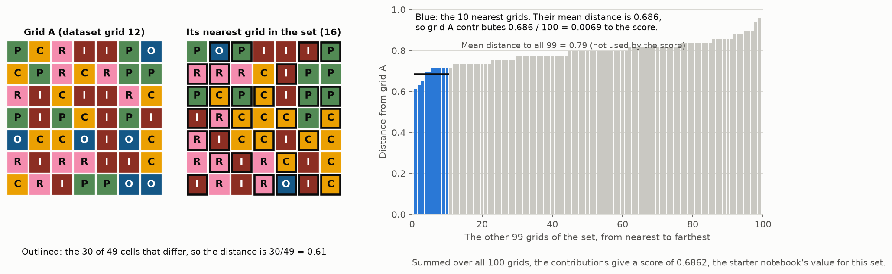

# 2.156 ps2 — Challenge Problem 2: City Zoning

MIT 2.156, Fall 2026 · Fatak Borhani, Joel Pederson, Leif Akerley

## Objective

Submit 100 city layouts (*grids*) of 7 × 7 cells, where each cell is one of five district types:
Residential, Industrial, Commercial, Park or Office.
- **The advisors.** Four *advisors* (Wellness, Tax, Transportation and Business) are scoring functions
  held by the course staff. Each gives a grid a *rating* between 0 and 1, and their formulas are not
  available.
- **Validity.** A grid *passes* an advisor if rated at least 0.75, and is *valid* if it passes all
  four.
- **The score.** A submission's *score* counts only its valid grids: for each one, the mean distance
  to its 10 nearest other valid grids (the fraction of the 49 cells in which two grids differ),
  summed and divided by 100.
- **What we have to work with.** The course provides 5,000 example ratings per advisor. The course
  *scoreboard* reports the score of up to five submissions per day per group (course Canvas page).

Due 13 November 2026, 11:59 pm (course Canvas page).

Course repository (data, district images, `utils_public.py`):
<https://github.com/decode-mit/2155-CP2-2026>, pinned to (held at) the commit recorded in
[`course_commit.txt`](course_commit.txt), so the course data and scoring code cannot change without
notice.

## What the score rewards

Every submission contains exactly 100 grids, and the score is always divided by 100. The score has
two parts: how many grids are valid, and how different the valid grids are from one another.

### Validity

A valid grid contributes at most 0.01 to the score, and an invalid grid contributes nothing. The score
therefore cannot exceed the number of valid grids divided by 100. With 90 valid grids, for example,
the maximum is 0.90.

### Diversity

The score measures diversity in three steps (Figure 1):

1. **Distance between two grids.** This is the fraction of the 49 cells in which the two grids hold
   different districts: 0 for identical grids and 1 for grids that differ in every cell. In Figure 1,
   grid A (dataset grid 12) and its most similar grid in the set differ in 30 of 49
   cells, a distance of 0.61.
2. **Each valid grid's contribution.** The grid's distances to all other valid grids are computed,
   and the 10 smallest (its 10 nearest neighbours) are averaged. That average, divided by 100, is the
   grid's contribution. For grid A, the 10 nearest average 0.686, so it
   contributes 0.0069.
3. **The score.** The contributions of all valid grids are added. For the 100 grids of
   Figure 1, they sum to 0.6862.



**Figure 1. How the diversity score is computed.** The figure uses the 100 grids of the
starter notebook's scoring example (dataset grids 0–99), all treated as valid.
- **Left:** grid A (dataset grid 12) and the most similar grid in the set (dataset grid
  16), with the 30 cells in which they differ outlined.
- **Right:** grid A's distance to each of the other 99 grids, sorted. Only the 10
  nearest (blue) count toward grid A's contribution. Their mean is 0.686,
  whereas grid A's mean distance to all 99 is 0.79.

*Source: `python make_figures.py`, which computes these values and checks that the contributions sum
to the course's diversity score for the set.*

**What this rewards.** Only a grid's 10 nearest neighbours count. A grid with a few close neighbours
therefore contributes little, however different it is from the rest of the set. The score rewards a
set in which every grid is far from all the others, with no clusters of similar grids.
- **Duplicates.** The course allows identical copies, but they cost points.
- **Why.** A copy enters a grid's 10 nearest neighbours at distance 0 and pushes out the farthest of
  them. A grid submitted twice therefore loses at least a tenth of its contribution, and so does its
  copy.
- **The limit.** A grid submitted 11 or more times contributes nothing, because all of its 10
  nearest neighbours are copies.
- **Our rule.** This project's submission check rejects duplicates, to catch accidental copies.

**Reference points.** The starter notebook's Scoring Examples give a score of 0.6862 for the first
100 dataset grids treated as valid. When the first 50 of those designs are each submitted twice,
the score is 0.6194.
A score of 1 would require all 100 grids to be valid and each to differ from its 10 nearest
neighbours in every cell.

### Validity and diversity together

The two goals are expected to conflict. Grids that satisfy all four advisors with a wide margin must
reconcile the advisors' competing preferences in similar ways, so they are likely to resemble one
another. More varied grids, by contrast, are less certain to be valid. The aim is therefore not
simply to maximize the number of valid grids. It is to choose the 100 grids with the highest
*expected* score: the score averaged over the possible outcomes of which grids turn out valid.
- **Roughly,** each grid's contribution to diversity is weighted by its estimated probability of
  being valid.
- **Stage 4 estimates it more precisely,** by simulating many outcomes of which grids fail.
- **Where the stages fit.** The project's stages are listed under "Status". Stage 3 (designing grids)
  measures this trade-off, and Stage 4 (selecting the final 100) makes the final choice.

## Quick start

```bash
git clone git@github.com:Joel-Pederson/2.156-ps2.git   # or the https:// URL
cd 2.156-ps2
./setup_data.sh                          # course data at the pinned commit (about 70 MB, not committed)
mamba env create -f environment.yml      # first time; afterwards: mamba env update -f environment.yml --prune
conda activate ps2
python -m ipykernel install --user --name ps2 --display-name "Python (ps2)"
pytest                                   # the full test suite runs in a few seconds
```

## Running the code

```bash
./setup_data.sh --check        # report whether the course repository has changed since the pin
pytest                         # run the test suite
python validity.py             # model scorecard: accuracy tables for each model and advisor
                               #   (about 8 min on the first run, a few seconds after that)
python validity.py --grid 12   # one grid's predicted ratings against each advisor's approval cut-off
python validity.py --data      # counts of which grids each advisor rated
python make_figures.py         # regenerate the figures in docs/figures/
python tests/fault_injection.py   # confirm that the tests catch eleven deliberate faults
python search.py --list           # Stage 2: each advisor's model recipes (docs/stage2_models.md)
```

[`analysis.ipynb`](analysis.ipynb) (kernel "Python (ps2)") presents the results graphically. For a
map of which file each command uses and where its results go, see "How the code fits together" in
[`docs/stage1_evaluation.md`](docs/stage1_evaluation.md).

## Status

| Stage | Status | Documentation |
|---|---|---|
| 1. Evaluation protocol | Complete | [`docs/stage1_evaluation.md`](docs/stage1_evaluation.md) |
| 2. Models | In progress: harness built (`search.py`) | [`docs/stage2_models.md`](docs/stage2_models.md); [`docs/decisions.md`](docs/decisions.md) (entries of 28 October) |
| 3. Designing grids | Planned | |
| 4. Selecting and submitting the final 100 | Planned | |

**Stage 1 summary.** Terms, method, figures and caveats are in
[`docs/stage1_evaluation.md`](docs/stage1_evaluation.md).
- **Evaluation.** *Surrogate models* are models trained on the example ratings to predict each
  advisor's rating. They are evaluated on each advisor's *development set*: 4,000 rated grids used
  for training and comparisons.
  - Evaluation uses *five-fold cross-validation*: each model is trained on four-fifths of the
    development set and tested on the remaining fifth, five times over.
  - A *test set* of 1,000 rated grids per advisor is kept out of all training and model choices,
    and is evaluated once, after the final pipeline is fixed. Four early exploratory analyses saw
    all ratings before it was set aside (`docs/decisions.md`, "Disclosure of four analyses that used every rating").
- **Primary model.** Gradient-boosted trees (GBM, for gradient boosting machine: several hundred
  small decision trees, each correcting the errors of those before it) on 75 engineered features
  that describe how districts are arranged.
- **Comparison metric.** Models are compared by their *approval count at 98% precision*.
  - A model *approves* a grid when the grid's predicted rating is at or above a cut-off.
  - The approval count at 98% precision is how many development-set grids a model can approve while
    at least 98% of them truly pass.
  - For the primary model:

| | Wellness | Tax | Transportation | Business |
|---|---|---|---|---|
| Approval count at 98% precision (of 4,000) | 534 | 828 | 744 | 836 |
| Share of the advisor's truly passing grids approved | 52% | 86% | 74% | 84% |

*Source: `python validity.py` (means over three random divisions of the development set into
folds).*
- **What is checked.** Each advisor's model is checked only on the grids that advisor rated. Whether
  a grid passes all four advisors is predicted, not checked (`docs/stage1_evaluation.md`, "What can
  and cannot be checked").
- **Next.** Wellness is the limiting advisor and the first target of Stage 2.

## Repository layout

| Path | Committed | Contents |
|---|---|---|
| [`docs/stage1_evaluation.md`](docs/stage1_evaluation.md) | yes | Stage 1 write-up: data split, features, models, scorecard |
| [`docs/stage2_models.md`](docs/stage2_models.md) | yes | Stage 2 write-up: nested cross-validation, how a challenger replaces the incumbent (in progress) |
| [`docs/decisions.md`](docs/decisions.md) | yes | Dated record of decisions and the evidence for each; source for the reflection report |
| [`docs/plan.md`](docs/plan.md) | yes | The approved project plans: the original (25 October) and Stage 2's (28 October) |
| `docs/figures/` | yes | Figures used in the documentation (generated by `make_figures.py`) |
| [`features.py`](features.py) | yes | Converts grids into model inputs: one-hot encoding (one indicator per cell and district) and 75 engineered features |
| [`validity.py`](validity.py) | yes | Evaluation protocol: data loading, test set, cross-validation, model scorecard |
| [`search.py`](search.py) | yes | Stage 2's harness: nested cross-validation, the recipe registry, the adoption test |
| [`scoring.py`](scoring.py) | yes | Submission format check, and a score calculation identical to the course's |
| [`plots.py`](plots.py), [`make_figures.py`](make_figures.py) | yes | All figures, and the script that saves those used in the documentation |
| [`analysis.ipynb`](analysis.ipynb) | yes | Graphical results; extended at each stage |
| [`tests/`](tests) | yes | Automated checks of the evaluation protocol, features, scoring and figure colours; `fault_injection.py` confirms that the checks catch deliberate faults |
| [`setup_data.sh`](setup_data.sh), [`course_commit.txt`](course_commit.txt) | yes | Downloads the course data at the pinned commit; `--check` reports updates |
| [`environment.yml`](environment.yml), [`environment-ci.yml`](environment-ci.yml) | yes | Conda environments: full (day-to-day work) and slim (GitHub's test runs) |
| [`pyproject.toml`](pyproject.toml) | yes | pytest settings |
| [`.github/workflows/`](.github/workflows) | yes | GitHub Actions: the tests on every push, and a daily check for course-repository updates. GitHub runs the daily check only once the workflow file is on `main`; until then, run `./setup_data.sh --check` by hand |
| [`starter_notebook.ipynb`](starter_notebook.ipynb) | yes | The assignment notebook, adapted to run locally. Its saved outputs come from a run before the test set was set aside; re-running it locally now hides the test-set ratings (on Colab, where it cannot, it stops) |
| `submissions/` | yes | Submitted `.npy` files (NumPy array files) |
| `docs/lockbox_log.md` | yes | Record of every test-set opening, written by `validity.open_lockbox()`; created at the first opening |
| `data/cp2-repo/` | no | Copy of the course repository: grids, ratings, district images, `utils_public.py` |
| `data/cache/oof/` | no | Out-of-fold predictions saved by `validity.py`; safe to delete (recomputed on demand) |

## Collaboration

Each team member develops an independent approach. The strongest, judged by scoreboard score, is
merged into `main` at the end; results computed on our own data splits are not comparable across
different methods.

```text
main  <──────────── final: the team's best solution
  ├── joel_dev  <── each stage merged after review
  │     ├── joel_stage1   (evaluation protocol)
  │     └── joel_stage2   (models), ...
  ├── Fatak's branches
  └── Leif's branches
```

- **Scoreboard budget.** The five daily submissions are shared by the group; the allocation is agreed
  in advance.
- **Notebooks.** Pull before editing, push promptly, and announce which notebook is being edited.
  Enable notebook-aware comparison of versions once with `nbdime config-git --enable` (nbdime is
  included in `environment.yml`). Notebooks are committed with their outputs.

## Deliverables (each team member submits individually)

- A single `.npy` file (NumPy array file): a 100 × 7 × 7 integer array with values 0–4
- A zip archive of the code
- An AI-use statement, if the course's generative-AI policy requires one (check the course policy
  document): the tools used, what each was used for, and what you contributed
- A reflection report (PDF), drawing on [`docs/decisions.md`](docs/decisions.md) and the stage
  documents
