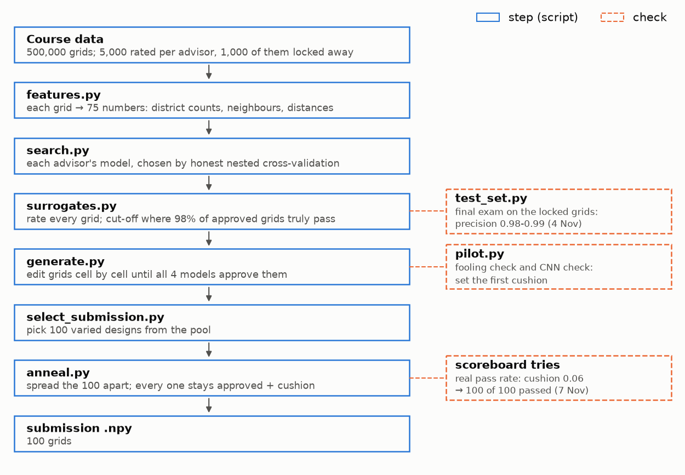
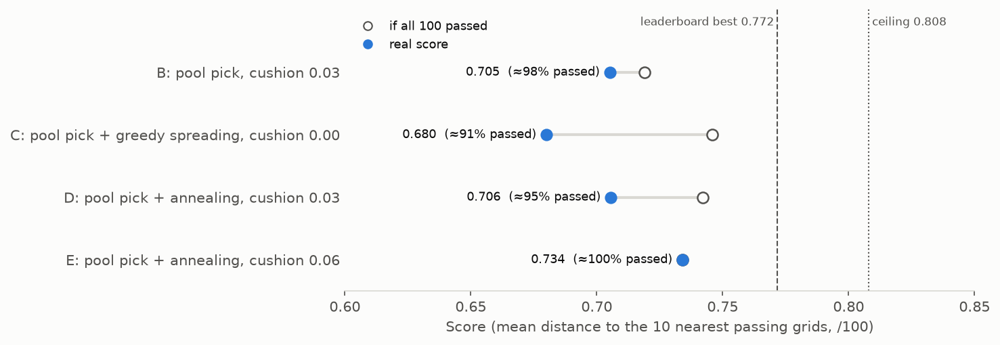

# How the code fits together

**Goal:** 100 grids that all four advisors rate ≥ 0.75, as different from one another as possible.
We can't query the advisors, so we:
1. train a model per advisor;
2. design grids those models approve, with a safety cushion;
3. spread the designs apart;
4. check on the real scoreboard.

*Source: `python make_figures.py --stage 4`.*

## The steps

| Step | Script | What it does | Output |
|---|---|---|---|
| Data | `validity.py` | Loads 500,000 grids and the ratings; locks 1,000 rated grids per advisor away as the final exam | — |
| Features | `features.py` | A grid → 75 numbers: district counts, neighbour pairs, distances (`features_lab.py`: 148 more) | — |
| Models | `search.py` | Up to 6 recipes per advisor, each scored by nested cross-validation (never on grids it trained on); a challenger replaces the incumbent only if clearly better | `data/cache/nested/` |
| Ratings | `surrogates.py` | Refits each advisor's model; rates all 500,000 grids; sets each *cut-off* where 98% of approved grids truly pass | `data/cache/ratings/` |
| Designs | `generate.py` | From a random dataset grid, changes one cell at a time until all four models approve with a cushion | `data/designs/pool_*` |
| Pick | `select_submission.py` | 100 designs from the pool, each as far as possible from those already picked | `submissions/designs_*` |
| Spread | `anneal.py` | Simulated annealing: moves the 100 apart one cell at a time; every design stays approved | `submissions/anneal_*` |

**Models in force** (final since the test set opened, 4 Nov):

| Advisor | Model | Inputs |
|---|---|---|
| Wellness | GBM (gradient-boosted trees) | 75 features + every cell's district |
| Tax | GBM | 75 features |
| Transportation | mean of 4 GBMs | each member's inputs |
| Business | GBM | 75 features + up to 3 extra feature groups |

A CNN that reads the raw grid lost to the GBMs for every advisor. It is kept only as a second
opinion: the CNN check below.

## The checks, and what they showed

| Check | Script | Question | Result |
|---|---|---|---|
| Final exam | `test_set.py` | Precision of each model on the 1,000 locked grids per advisor | 0.983–0.995, all at or above expected (4 Nov) |
| Fooling check | `pilot.py --margin` | A model trained on half the data designs; one trained on the other half grades. Are designs failed more than ordinary grids? | Passed at cushion 0.15 for Wellness, 0.10 for the others |
| CNN check | `pilot.py --check` | Same, with the CNN as grader | Flagged all four advisors, but the scoreboard showed it was a false alarm (below) |
| Scoreboard | by hand, ≤ 5 a day | The real score; divided by the score if all passed, it gives the share that truly passed | [`scoreboard.csv`](scoreboard.csv) |

## What we learned on the scoreboard (7 Nov)

- **Our models are trustworthy with a cushion.**
  - Pool designs at cushion 0.03: about 98% passed.
  - Annealed designs at cushion 0.06: 100% passed.
  - Designs pushed to the bare cut-off: about 91% passed.
- **The search method was the real limit, not the models.**
  - Picking from a pool gives 0.68–0.72.
  - Greedy one-cell spreading stops at about 0.755, even with no approval rule.
  - Annealing reaches 0.774 with no rule.
  - The hard ceiling for any 100 grids is 0.808.
- **Both pilot checks were too cautious.**
  - The CNN check flagged even the cushion-0.15 designs.
  - The fooling check flagged Tax at cushion 0.03.
  - Yet pool designs at 0.03 passed at about 98%.

## Where things are saved

| Path | Holds | In git |
|---|---|---|
| `data/cache/` | model predictions and ratings (recomputed on demand) | no |
| `data/designs/` | design pools and pilot results | no |
| `submissions/` | every submitted `.npy`, with a `.json` of settings where a script made it | yes |
| `results/` | Excel tables of every comparison and check | no |
| `docs/decisions.md` | every decision, dated, and the checks fixed before their results | yes |

## Words

- **Cut-off:** an advisor model's approval line. Of the grids above it, 98% truly pass.
- **Cushion (margin):** how far above the cut-off a design must be. We use 0.06 for annealed
  designs.
- **Approved:** above the cut-off plus cushion, for all four models.
- **Nested cross-validation:** each score comes from grids the model never trained on, including
  for the choice of its settings.
- **Simulated annealing:** a search that sometimes accepts a worse change early on, so it can leave
  a local peak; it accepts fewer as it "cools".
