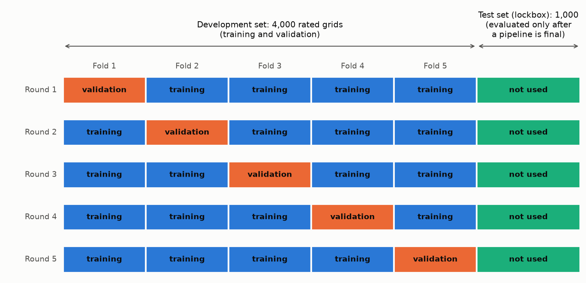
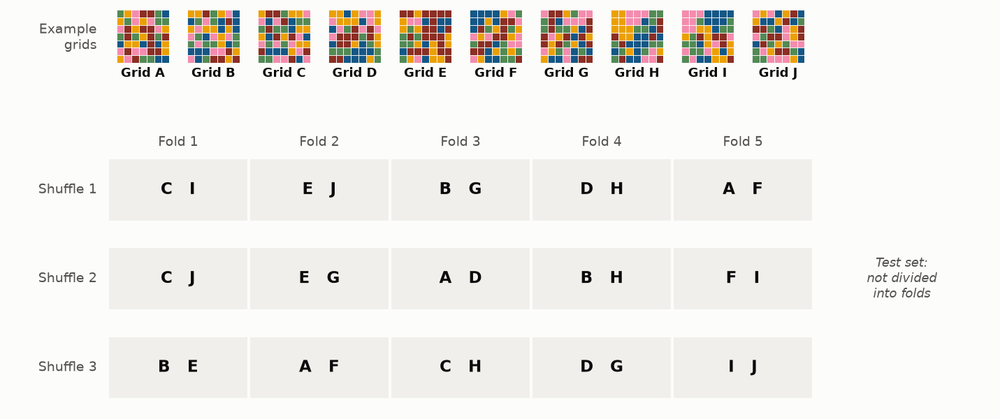
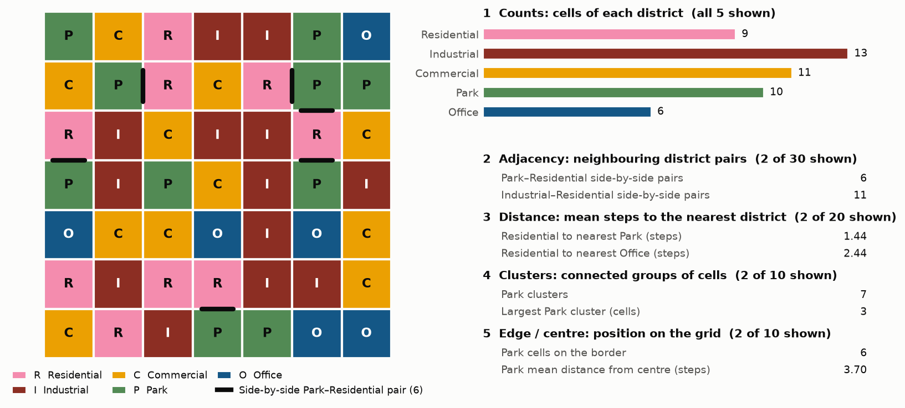
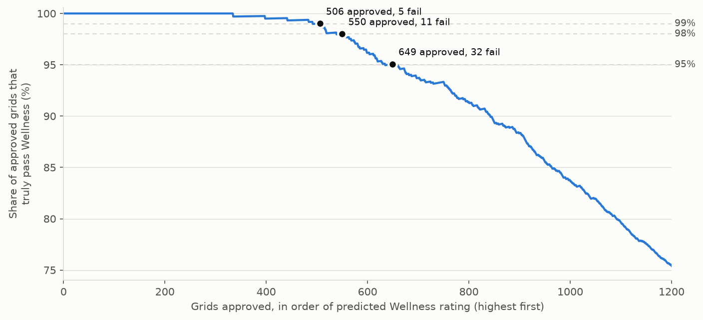

# Stage 1: Evaluation protocol

Part of the documentation for 2.156 Challenge Problem 2. The [README](../README.md) gives the
project objective, setup and how to run the code; [`decisions.md`](decisions.md) records each
decision and its evidence. Near the end, "How the code fits together" maps the code: the path from
course data to a submitted file, what each command runs, and where its results go.

**Terms used throughout.**
- A *grid* is a 7 × 7 city layout; each cell holds one of five district types.
- Each of four *advisors* (Wellness, Tax, Transportation, Business) is a scoring function held by
  the course staff. It gives a grid a *rating* between 0 and 1.
- A grid *passes* an advisor if rated at least 0.75, and is *valid* if it passes all four.
- A model *approves* a grid for an advisor when the grid's predicted rating is at or above that
  advisor's *approval cut-off*. Its *precision* is the fraction of the grids it approves that truly
  pass. Both are defined in full under "Model scorecard".
- The *starter notebook* is `starter_notebook.ipynb`, the course's assignment notebook, adapted to
  run locally.
- A submission's *score* (the course's diversity score) counts only its valid grids. Each one
  contributes its mean distance to its 10 nearest other valid grids, divided by 100 (README, "What
  the score rewards"). The course *scoreboard* reports the score for up to five submissions per day
  per group (course Canvas page; the scoreboard has not been released yet).
- The project has four *stages*: 1, this evaluation protocol; 2, models; 3, designing new grids;
  4, selecting and submitting the final 100 (README, "Status").

Because the advisors cannot be queried directly, later stages rely on *surrogate models*. These are
models trained on the example ratings to predict each advisor's rating for any grid. Stage 1
defines how those models are evaluated. The aim is to prevent *leakage*, meaning evaluation data
influencing training or model choices, which would make the measured accuracy look better than it
is.

## Data

The dataset contains 500,000 grids. Each cell holds one of five district types:

| Code | District | Letter in figures |
|---|---|---|
| 0 | Residential | R |
| 1 | Industrial | I |
| 2 | Commercial | C |
| 3 | Park | P |
| 4 | Office | O |

- **Rated grids.** Each advisor rated 5,000 grids (course README). The course does not say how
  those grids were chosen.
- **Overlaps.** If each advisor's 5,000 grids were an independent random sample of the dataset, any
  two advisors would share about 50 grids. The observed overlaps are 36–64 per pair of advisors.
- **Is each a random sample?** The overlaps show only that the four advisors' samples were drawn
  independently of one another, not that each is a random sample of the dataset. Checks made in the
  26 October audit support that too: rated and unrated grids have matching district compositions,
  and a classifier given the 75 engineered features cannot tell them apart. These checks are
  recorded in `docs/decisions.md` (26 October) but are not yet part of `python validity.py --data`.
  Each advisor's grids are therefore treated as a random sample; "What can and cannot be checked"
  relies on this assumption.
- **Grids rated by more than one advisor.** Only 286 grids are rated by two or more advisors (283 by
  two, 3 by three), and none by all four.
- **Unrated grids.** The remaining 480,289 grids are unrated. Later stages use them as starting
  points for generating designs.

*Source: `python validity.py --data`, which counts which grids are rated without reading any
rating. `tests/test_protocol.py` checks the counts.*

## Data split

Each advisor's 5,000 rated grids are split by the same procedure (Figure 1):

- **Test set (the "lockbox"): 1,000 grids.**
  - These are excluded from all training and *model selection* (choosing among models, features and
    settings; see "Validation and test sets").
  - The test set is evaluated once, after the final *pipeline* is fixed and its expected test-set
    precision has been recorded in `docs/decisions.md` (rule 2.7). A pipeline is the complete chain
    of features (the model's inputs; see "Features"), the model, and the decision rules (fixed
    thresholds that turn predictions into actions, such as which grids to approve). Any further
    opening would be logged and disclosed.
  - Test results are never used to choose between alternatives.
  - In this project's own code (`validity.py`, `features.py`, `scoring.py`, `plots.py`,
    `make_figures.py`, `analysis.ipynb` and `tests/`), the test-set ratings are reached only
    through `validity.open_lockbox()`. It requires
    explicit confirmation and records every opening (time, commit and reason) in
    `docs/lockbox_log.md`.
  - The standard loader, `validity.load_dev()`, returns test-set ratings as NaN ("not a number",
    the marker for a missing value). The only other code that reads the raw data
    (`python validity.py --data` and the leakage tests) reads which grids are rated, never a
    rating.
  - **Exception: the starter notebook.** It loads every rating directly, test set included, and
    trains on all of them. Its saved outputs come from a run on 25 October, before the test set
    was set aside; that run is listed in the decision log's disclosure. Re-running its model cells
    would use test-set ratings with no log entry, so they must not be re-run.
  - All 286 grids rated by two or more advisors are assigned here. They are the only grids with two
    true ratings, so they are the only way to check whether two models are wrong on the *same* grid.
    That check is small: 36–64 grids per pair of advisors, none rated by all four. The dependence
    that matters most for the joint estimate needs only one true rating per grid and can be measured
    on the development set instead (see "What can and cannot be checked").
- **Development set ("dev" in the code, as in `load_dev()`): 4,000 grids.** These are used for
  training, validation and every model comparison, through *k*-fold cross-validation with
  *k* = 5:
  1. The 4,000 grids are divided at random into five *folds* of 800.
  2. A model is trained on four folds (3,200 grids) and evaluated on the remaining fold, the
     *validation fold*.
  3. Step 2 is carried out once for each fold, five *rounds* in all, so that each fold serves once
     as the validation fold. Every grid in the development set thereby receives an *out-of-fold
     prediction*: a predicted rating from a model that did not train on it (explained after
     Figure 2).



**Figure 1. Data split and five-fold cross-validation for one advisor.** The 5,000 rated grids are
divided into a development set of 4,000 grids and a test set (the lockbox) of 1,000. The development
set is divided into five folds of 800 grids. In each of five rounds, a new model is trained on four
folds and validated on the remaining one: fold 1 in round 1, fold 2 in round 2, and so on. The test
set is not used in any round. Each advisor's rated grids are split by the same procedure.

**Shuffle procedure.** The division into folds in step 1 is random; one such random assignment is
called a *shuffle*. Each shuffle is fixed by a *seed*, the starting value of the random-number
generator, so that it can be reproduced exactly. The five rounds are carried out once for each of
three independent shuffles (seeds 0, 1 and 2; Figure 2):

- **Reported values.** Within one shuffle, the five validation folds together give every
  development-set grid one out-of-fold prediction. Each metric (the approval count and R², defined
  under "Model scorecard") is computed on those 4,000 predictions, and the reported value is the
  mean over the three shuffles. For the approval count, the *scorecard* (the tables printed by
  `python validity.py`) also lists the three per-shuffle values, which show how much a result
  varies from the random division alone.
- **Noise threshold.** R² (the coefficient of determination, a standard accuracy measure: 1 for
  perfect predictions, 0 for no better than predicting the average rating; see "Model scorecard")
  is also computed separately for each of the 15 validation folds (3 shuffles × 5 rounds). The
  standard deviation of those 15 values is the *R² noise threshold*: a difference in R² between two
  models smaller than this is not treated as an improvement. For the *primary model* (the main
  model, chosen during planning: gradient-boosted trees on engineered features; see "Models") it
  ranges from 0.002 to 0.009.
- **What the noise threshold is not.** It measures how much a single fold's R² varies with that
  fold's difficulty. It is not the uncertainty of a *difference* between two models scored on the
  same folds: for two similar models the difference varies much less, so the threshold is too
  strict, and for dissimilar models it can be too lenient. Stage 2 compares close variants by their
  paired, fold-by-fold differences instead (`docs/decisions.md`, 26 October).



**Figure 2. Shuffle procedure, illustrated with ten example grids (A–J) in place of the 4,000
development-set grids.** Each row shows one random assignment ("shuffle") of the same ten grids to
the five folds of Figure 1. Under shuffle 1, for example, round 1 trains on grids A, B, D–H and J and
validates on grids C and I (fold 1); under shuffle 2, round 1 validates on grids C and J instead.
Grid B falls in fold 3 under shuffle 1 and in fold 1 under shuffle 3. The test set is never divided
into folds.

**Out-of-fold predictions.**
- **Definition.** In each round, the model trained on four folds predicts the ratings of the grids
  in the fifth, which it has never seen. Each such prediction is an *out-of-fold prediction*: the
  grid was outside ("out of") the folds the model was trained on.
- **Example.** Under shuffle 1 in Figure 2, round 1 trains a model on grids A, B, D–H and J. Its
  predictions for grids C and I are their out-of-fold predictions.
- **Coverage.** After five rounds, every grid in the development set has one out-of-fold
  prediction per shuffle. Every result in the scorecard is computed from these predictions.
- **Why only these are used.** A model's prediction for a grid it was trained on is unrealistically
  accurate, because the model has seen that grid's true rating and may partly have memorized it.
  An out-of-fold prediction reproduces the situation the model faces with a new grid, whose rating
  it has never seen.

**Validation and test sets.** *Model selection* means choosing among models, features and settings
by comparing their validation results. Each time the best of several options is chosen, part of its
apparent advantage may be chance: the particular validation grids happened to suit it. After many
such choices, validation results overstate accuracy on new grids; this effect is called *selection
bias*. The test set is consulted only after the choices are fixed, so its estimate of accuracy on
grids drawn like the rated ones is nearly unbiased. It does not measure accuracy on designed grids,
which later stages address separately. Two qualifications apply:
- **Early exposure.** Four exploratory analyses saw the test-set ratings before the split was fixed.
  `docs/decisions.md` records them, how their influence was limited (no number from them is used as
  evidence), and the exposure that remains. Choices made after them may carry a small optimistic
  bias.
- **Resolution.** At the development set's approval rates, each advisor's 1,000 test grids contain
  only about 130–210 approved grids. A precision measured on so few grids is uncertain by about one
  percentage point (one standard deviation), so the test set can reliably detect only large drops.

## Features

A model's inputs are called *features*. Two input representations are used:

- **One-hot encoding (245 features).** There is one indicator per cell and district type (49 cells
  × 5 types), equal to 1 if the cell holds that district and 0 otherwise. It specifies the district
  of every cell, and therefore the entire grid. However, it states no relationship between cells
  explicitly. A model must learn from the training grids which combinations of indicators mean, for
  example, that a Park is next to a Residential cell.
- **Engineered features (75 features).** These are measures of spatial relationships computed
  directly from the grid. They were designed by hand from the advisors' stated priorities, such as
  access to green space and commuting distance, and fall into five groups:

| Group | Measure | Features |
|---|---|---|
| Counts | Number of cells of each district | 5 |
| Adjacency | Number of neighbouring cell pairs for each pair of districts, including a district with itself (15 pairs), counted separately for side-by-side and diagonal neighbours | 30 |
| Distance | For each ordered pair of different districts: the mean number of steps (moves up, down, left or right) from a cell of the first to the nearest cell of the second | 20 |
| Clusters | Number of *clusters* of each district (groups of cells joined side by side), and the size of the largest | 10 |
| Edge / centre | Number of the district's cells on the border, and the mean number of steps from the centre cell to the district's cells | 10 |

*Absent districts.* Some grids lack a district entirely. Every distance to or from a missing
district is then 13 (one more than the 12 steps between opposite corners, so "absent" reads as
"very far"). Its centre distance is 0, the same value as a single cell at the centre; its count of
0 tells the two cases apart.



**Figure 3. One grid and 13 of its 75 engineered features.** Left: grid A from Figure 2 (dataset grid
12), with each cell coloured and lettered by district. The black bars mark the grid's six side-by-side
Park–Residential pairs, the quantity counted by one adjacency feature. Right: all five count features
and two examples from each of the other four groups. Each group repeats its pattern for every
district or district pair; for example, "Park cells on the border" has a counterpart for each of the
other four districts. `analysis.ipynb` lists all 75 values for any grid.

**Orientation.** All 75 engineered features are unchanged when a grid is rotated or reflected. The
choice rests on the *planning experiments*, exploratory runs on the development set made before
Stage 1 and recorded in `docs/decisions.md`:
- **The experiment.** The primary model was also given the 245 one-hot indicators, which record
  each cell's position, in addition to its engineered features.
- **The result.** R² changed by −0.003 to +0.004 across the four advisors. This comes from a
  one-off planning script that is not in the repository (`docs/decisions.md`, 25 October).
- **What it does and does not show.** A change that small was read as "the advisors appear
  insensitive to orientation". The 26 October audit found that reading too strong:
  - For Wellness, compared fold by fold on the same 15 folds, the one-hot indicators in their true
    orientation helped in almost every fold. They also beat the same indicators computed on
    randomly rotated and reflected copies of each grid in every fold.
  - Tax shows the same pattern, more weakly.
  - The effect is small but consistent. It may mean these advisors care about orientation, or that
    the dataset itself has orientation patterns; the data cannot separate the two.
- **Next.** Stage 2 tests this directly (rule 2.2 in `docs/decisions.md`). Until then, Wellness and
  Tax are treated as orientation-sensitive: no *augmentation* (adding the seven rotated and
  reflected copies of each training grid, each with that grid's rating), and no rotated copies in
  submissions. No Stage 1 model uses augmentation.

## Models

Four models are compared: two model types, each given each of the two input representations.

- **Ridge regression** is a linear model.
  - Its predicted rating is a weighted sum of the inputs. The weights are fitted to the training
    grids under a penalty that keeps them small.
  - The penalty limits *overfitting*: fitting quirks of the training grids that do not hold for
    other grids, which makes a model less accurate on new grids than on those it was trained on.
  - Implemented with scikit-learn.
- **Gradient-boosted trees (GBM, for gradient boosting machine)** combine several hundred small
  *decision trees*, added one at a time.
  - A decision tree predicts by asking a short sequence of yes/no questions about the inputs, such
    as "more than 8 Park cells?". Each final answer leads to a predicted rating.
  - Each new tree is fitted to the errors left by the trees before it.
  - Unlike a linear model, a GBM can represent thresholds (an effect that starts only above some
    value) and interactions (the effect of one input depending on the value of another).
  - Implemented with the LightGBM library.

Each model is named by its type and its input. For example, *Ridge regression on engineered features*
is a Ridge regression model given the 75 engineered features, and *GBM on one-hot inputs* is a GBM
given the 245 one-hot indicators. In code and printed output the four are `ridge_onehot`,
`ridge_engineered`, `gbm_onehot` and `gbm_engineered`. The *primary model*, chosen during planning
(`docs/decisions.md`, 25 October), is GBM on engineered features.

## What can and cannot be checked

The course staff can compute all four advisors' ratings for any grid, including new designs, and
the scoreboard score depends on all four. Our data is more limited. Each rated grid in the course
data carries a true rating from one advisor only, except 286 grids rated by two or more advisors
(283 by two, 3 by three; all held in the test set). Two consequences follow:

- **Each advisor's model is checked separately,** on the grids that advisor rated. The scorecard
  below reports these per-advisor results.
- **A grid's validity is predicted, not checked.** For any grid, each of the four models predicts
  its own advisor's rating.
  - The grid is *approved* for an advisor if that prediction is at or above the advisor's *approval
    cut-off*, a threshold set on the development set (defined under "Model scorecard").
  - The grid is *predicted valid* only if it is approved for all four advisors.

For example, grid A of Figure 2 (dataset grid 12) was rated only by Wellness. The primary model
gives:

| Advisor | Predicted rating | Approval cut-off | Approved? | True rating in the development set |
|---|---|---|---|---|
| Wellness | 0.840 | 0.824 | Yes | 0.867 |
| Tax | 0.203 | 0.772 | No | None |
| Transportation | 0.800 | 0.775 | Yes | None |
| Business | 0.641 | 0.765 | No | None |

*Source: `python validity.py --grid 12`. The Wellness prediction is out of fold, so it can be compared
with the true rating. The other three come from models trained on those advisors' whole development
sets. Each of the 286 grids rated by two or more advisors is in the test set for every advisor that
rated it. Grid 12 has a development-set Wellness rating, so it is not one of them, and no other
advisor rated it.*

Only the Wellness prediction can be checked against a true rating. Grid A is not approved for Tax or
Business, so it is predicted invalid and would not be submitted. New designs have no true ratings at
all, so all four of their ratings are predictions.

**Why a model's record applies to grids its advisor never rated.**
- **How the checking works.** No grid is checked against all four advisors. Each model is checked
  on its own advisor's rated grids, and then all four models are applied to every candidate.
- **Example.** The Tax model's record is measured on grids that Tax rated, yet it is used to judge
  grid A, which Tax never rated.
- **Why that is justified.** Both come from the same pool: each advisor's rated grids are treated as
  a random sample of the 500,000 (see "Data"). The Tax model's precision on its development set is
  therefore a fair estimate of its precision on other dataset grids, such as grid A.
- **Where it stops.** The argument does not cover new designs. They are not random draws from the
  dataset, and a design search keeps the grids the models rate highly. That tends to concentrate
  designs where the models over-predict. Stage 3 measures the models' accuracy on designs
  separately.

**How the joint estimate is tested.** How often a grid predicted valid is truly valid can only be
estimated, by combining the four models' separate records (see "Why 98%" below). Two sources test
that estimate, each only in part:
- **The 286 grids rated by two or more advisors,** held in the test set.
  - What they can show: whether two models are wrong on the *same* grid, for each pair of advisors
    (36–64 grids per pair). Failures that coincide leave more grids valid (see "Why 98%"), so this
    matters less than it seems.
  - What they cannot show: whether a grid approved for both advisors of a pair truly passes both.
    At 98% precision the primary model approves 13–21% of each advisor's development-set grids. If
    approvals were independent, only about ten of the 286 grids would be approved by both models of
    their pair; for example, Transportation–Business gives 64 × 744/4,000 × 836/4,000 ≈ 2.5.
    Approvals are not independent, because the advisors' preferences conflict, so the true number
    is probably smaller.
  - None of them was rated by all four advisors.
  - Rule 2.8 in `docs/decisions.md` fixes in advance how the result is used.
- **The development set, for what matters more.** Whether one model's precision drops on grids that
  another advisor's model rates highly needs only one true rating per grid. It can be measured on
  the development set, by applying each model to the other advisors' rated grids, with far more
  grids than the test set offers. Stage 2 does this (`docs/decisions.md`, 26 October).
- **The scoreboard.**
  - It rates every submitted grid with all four advisors. It is expected to report only the total
    score; it has not been released yet.
  - An invalid grid usually lowers the score, by an amount that depends on the set: 0.0064 in the
    starter notebook's well-spread example (see "What it costs"), less in a set of similar grids.
    The number of failures should therefore be estimated by simulation on the submitted set itself:
    remove grids at random and find how many removals match the reported gap.
  - Even an exact count from one submission is weak evidence, because the number of failures among
    100 grids varies by chance.
  - It does not reveal which grids failed, or which advisor rejected them.

## Model scorecard

**How a model is used.** For each advisor, a model predicts the rating of every grid. A grid is
*approved* for that advisor when its predicted rating is at or above a chosen value, the *approval
cut-off*. Two quantities describe how well this works:

- **Precision:** the fraction of approved grids that truly pass the advisor (true rating at least
  0.75). A precision of 98% means that 2 of every 100 approved grids actually fail.
- **Approval count:** the number of grids approved. A higher count leaves more candidates from which
  to choose a diverse final set.

The two trade off against each other. Approving only the grids with the highest predicted ratings
gives high precision but a small count; approving more grids raises the count but lowers precision.

**Comparison metric: approval count at 98% precision.**
- **Definition.**
  - To compare models on equal terms, precision is held at 98% and each model's approval count is
    measured.
  - The development-set grids are sorted by predicted rating, highest first, and approved one at a
    time down the list. Approval stops at the last point at which at least 98% of the approved
    grids truly pass.
  - The number approved at that point is the approval count (Figure 4). The predicted rating of the
    last grid approved is the approval cut-off.
  - For the primary model, the cut-offs are 0.824 (Wellness), 0.772 (Tax), 0.775 (Transportation)
    and 0.765 (Business), each the mean over the three shuffles.
- **Interpretation.** A higher count means the model identifies more passing grids at the same
  reliability.
- **Caveat.** The cut-off is chosen using the true ratings of the same grids it is measured on, so
  the count is somewhat optimistic for new grids. It ranks models but does not guarantee
  performance.



**Figure 4. How the approval count at 98% precision is measured (Wellness, primary model, shuffle
1).** The 4,000 development-set grids are sorted by predicted Wellness rating, highest first, and
approved one at a time from the left. The curve shows the share of the approved grids that truly
pass Wellness. The approval count at a precision level is the last point at which the curve is at or
above that level. The marked points show, for precision levels of 95%, 98% and 99%, how many grids
are approved and how many of those truly fail. The scorecard reports the mean of the three
shuffles' approval counts.

**Risk of approving more grids.**
- **What it costs.** Each of the 100 submitted grids occupies one slot, and an invalid grid scores
  nothing in it. A valid grid can contribute at most 0.01 to the score. In the starter notebook's
  Scoring Examples, removing the first of the first 100 dataset grids, as happens when a grid is
  invalid, lowers the score by 0.0064. That holds for a well-spread set. In a set of similar grids,
  as a submission of grids predicted valid is likely to be, a failure costs less. Removing a grid
  can even raise the score, because its neighbours then count a farther grid among their 10
  nearest.
- **Why it grows.** Each step to the right approves a grid with a lower predicted rating, which is
  more likely to truly fail.
- **How fast.** In Figure 4, relaxing the requirement from 98% to 95% precision approves 99 more
  grids (550 to 649) but adds 21 failures (11 to 32). About one in five of the added
  grids fails, although overall precision falls only to 95%.
- **Beyond Figure 4.** The risk compounds across the four advisors (see "Why 98%"). It is also
  likely to be higher for designed grids, which are less familiar to the models; Stage 3 measures it
  directly.
- **When it can still pay.** Approving more grids gives a larger set of candidates, from which a more
  diverse final 100 can be chosen. Relaxing precision is worthwhile only if that gain in diversity
  outweighs the score lost to the additional invalid grids. Stage 4 chooses the final 100 on exactly
  this basis.

**Why 98%.**
- **The arithmetic.** A grid counts toward the score only if it passes all four advisors. If each
  advisor's model is correct for 98% of the grids it approves, a grid approved for all four advisors
  is valid with probability of about 0.98 × 0.98 × 0.98 × 0.98 ≈ 92%.
- **An average, not a per-grid chance.** The 98% is averaged over all of a model's approved grids,
  most of which sit well above the cut-off. Grids just above the cut-off fail far more often than 2
  in 100; grids well above it almost never fail. So 92% describes a grid drawn at random from the
  approved grids, not one that only just clears all four cut-offs, which is much less likely to be
  valid (`docs/decisions.md`, 26 October). A design search tends to push grids just past the
  cut-offs, so designs need a margin above them, and Stage 4 must estimate each grid's chance of
  passing from how far above the cut-offs its predictions sit.
- **Related errors.** That product treats the four models' errors as unrelated. At 98% it is close
  to the worst case. Suppose each model wrongly approves at most 2 of every 100 submitted grids.
  Then at most 8 of the 100 fail any advisor, so at least 92% are valid, however the errors are
  related. If the models tend to fail on the same grids, more than 92% are valid.
- **The assumption that matters.** Each model's 98% precision is measured on development-set grids.
  The 92% holds only if that precision carries over to the grids actually submitted, and two things
  could break it:
  - The submitted grids are those approved by all four models, not a random sample of one model's
    approvals, and a model's precision on that subset may be lower. The test-set grids rated by two
    or more advisors give weak evidence on this (rule 2.8).
  - Designed grids differ from the dataset. The caveat above already makes the 98% somewhat
    optimistic for dataset grids. Stage 3 tests the models on designs.
  - The scoreboard measures the combined result, but cannot show which of these caused a
    shortfall.
- **The trade-off.** The table below shows it for the primary model:

| Precision per advisor | Valid for all four advisors, if errors are unrelated (precision⁴) | Expected invalid grids per 100 | Approval count: Wellness | Tax | Transportation | Business |
|---|---|---|---|---|---|---|
| 90% | 66% | 34 | 844 | 1,008 | 959 | 1,026 |
| 95% | 81% | 19 | 668 | 916 | 840 | 931 |
| **98%** | **92%** | **8** | **534** | **828** | **744** | **836** |
| 99% | 96% | 4 | 473 | 757 | 711 | 800 |

*Source: `python validity.py` (last table of its output), computed by `validity.precision_tradeoff()`
from the same out-of-fold predictions as the scorecard. Approval counts are means over the three
shuffles. The second column is the precision raised to the fourth power, and the third is 100 × (1 −
second column).*

**How precise the 98% is.** Each advisor's 98% rests on few failures: at most 2% of 534–836
approvals, about 11–17 grids. Each advisor's precision is therefore uncertain by roughly one
percentage point either way, and the expected number of invalid grids per 100 at this level is
roughly 4–13 rather than exactly 8 (`docs/decisions.md`, 26 October).

Raising precision from 98% to 99% halves the expected number of invalid grids but approves 4–11%
fewer. Lowering it to 95% approves 11–25% more but more than doubles the invalid grids. The 98% level
is a working balance used to compare models. The cut-offs used for the submitted grids are set by
experiment in Stage 3. They include a *safety margin* for designed grids: how far above 0.75 their
predicted ratings must be.

**R² (coefficient of determination).**
- **Definition.** R² is 1 minus the ratio of the model's mean squared prediction error to the
  variance of the true ratings. A value of 1 means perfect predictions; 0 means no better than
  predicting the average rating for every grid.
- **Why it is not the main metric.** It averages errors over all grids, including errors far from
  0.75, such as predicting 0.2 for a grid rated 0.3. Such errors never change whether a grid passes.
  The approval count measures only the decision that matters.
- **Where it is still used.**
  - R² is reported as a general check.
  - It sets the R² noise threshold.
  - It sets the Stage 1 completion check: the scorecard's R² values must match the planning
    experiments' to within 0.01.
  - It decides rule 2.2 in `docs/decisions.md` (whether position-dependent features help).

**Results.**

| Approval count at 98% precision: mean of the three shuffles [per-shuffle counts] | Wellness | Tax | Transportation | Business |
|---|---|---|---|---|
| Ridge regression on one-hot inputs | 67 [68/66/67] | 611 [612/608/612] | 0 [0/0/0] | 40 [4/62/55] |
| GBM on one-hot inputs | 76 [31/78/118] | 543 [562/512/556] | 5 [4/7/5] | 82 [104/74/69] |
| Ridge regression on engineered features | 242 [261/241/223] | 817 [814/822/815] | 19 [1/30/27] | 182 [185/185/177] |
| **GBM on engineered features** | **534 [550/523/528]** | **828 [842/815/828]** | **744 [745/750/738]** | **836 [847/814/847]** |
| *Approval cut-off (primary model)* | *0.824* | *0.772* | *0.775* | *0.765* |
| *Share of the advisor's truly passing grids that are approved (primary model)* | *52%* | *86%* | *74%* | *84%* |

| R² (mean of the three shuffles; ± the R² noise threshold, the spread of single-fold values) | Wellness | Tax | Transportation | Business |
|---|---|---|---|---|
| Ridge regression on one-hot inputs | 0.481 ± 0.027 | 0.757 ± 0.024 | 0.121 ± 0.029 | 0.481 ± 0.036 |
| GBM on one-hot inputs | 0.502 ± 0.025 | 0.704 ± 0.015 | 0.293 ± 0.026 | 0.495 ± 0.026 |
| Ridge regression on engineered features | 0.695 ± 0.024 | 0.871 ± 0.016 | 0.650 ± 0.020 | 0.603 ± 0.022 |
| **GBM on engineered features** | **0.888 ± 0.009** | **0.967 ± 0.002** | **0.935 ± 0.005** | **0.969 ± 0.004** |

*Source: `python validity.py`, which prints these tables. Bold rows are the primary model.*

Findings:

1. **Input representation matters more than model type, and Transportation needs both.**
   - Engineered features raise R² far more than switching to GBM does. For Transportation, the same
     GBM goes from R² 0.293 with one-hot inputs to 0.935 with engineered features.
   - On approval counts, Transportation needs both changes: GBM on one-hot inputs approves 5 grids
     and Ridge regression on engineered features 19, against 744 for GBM on engineered features.
2. **Wellness is the limiting advisor.** At 98% precision, the primary model approves 52% of
   the development-set grids that truly pass Wellness, compared with 74%–86% for the other
   advisors. It is the first target of the Stage 2 feature study (Stage 2's search for better
   features).
3. **The primary model leads for every advisor, by more than the noise for three of them.**
   - Across shuffles, the primary model's approval counts vary by at most 33 grids, and its R²
     noise threshold is 0.002–0.009.
   - For Wellness, Transportation and Business, its lead over every other model is far larger than
     that variation.
   - For Tax, GBM and Ridge regression on engineered features approve 828 and 817 grids. That gap
     is within the variation between shuffles: Ridge regression leads in shuffle 2, 822 to 815.
     Their R² values (0.967 and 0.871) differ far beyond the noise.
   - The spread across shuffles reflects only how the same 4,000 grids were divided into folds,
     not which grids happened to be rated, so it understates the uncertainty. Close comparisons in
     Stage 2 should be paired, fold by fold or by resampling grids.
4. **Stage 1 is complete.**
   - Its completion check required the R² values to match those of the planning experiments to
     within 0.01.
   - The largest difference is 0.0052, for GBM on one-hot inputs on Business. The check compares
     the scorecard's three-shuffle mean with the planning value, which used the first shuffle only.

`analysis.ipynb` presents these results graphically: approval counts by model (notebook Figure 5)
and predicted-versus-true plots for each advisor (notebook Figures 6–7).

**Where the numbers come from.**

| Numbers | Produced by |
|---|---|
| Grid and rating counts (500,000; 5,000; 286 = 283 + 3; 480,289; 36–64 per pair of advisors) | `python validity.py --data`, which reads only which grids are rated; checked by `tests/test_protocol.py` |
| Approval counts, approval cut-offs, shares, R² values, noise thresholds and the completion check | `python validity.py` |
| Precision trade-off table ("Why 98%") | `python validity.py`, via `validity.precision_tradeoff()` |
| Grid A's predictions and cut-offs | `python validity.py --grid 12` |
| Figures 1–4, and the counts quoted from Figure 4 | `python make_figures.py` (Figure 4 uses the saved predictions from `python validity.py`) |
| About ten co-rated grids approved for both advisors of their pair | The pair counts from `python validity.py --data` and the approval counts above, multiplied as shown under "How the joint estimate is tested" |
| Cost of one invalid grid (0.0064) | The starter notebook's Scoring Examples (Case 3) |
| R² change from adding the one-hot inputs (−0.003 to +0.004) | A one-off planning script, not in the repository; recorded in `docs/decisions.md` (25 October). Stage 2's rule 2.2 test will reproduce it |
| Scoreboard rules (five submissions per day per group) and the deadline | The course Canvas page: external, not in the repository |
| Audit observations quoted in words (orientation, per-grid pass rates, the random-sample checks) | The 26 October audit, recorded with its numbers in `docs/decisions.md`; its scripts are not yet in the repository |
| Planning-experiment R² values (completion check) | One-off exploratory scripts, run before the Stage 1 scorecard was added to `validity.py`; recorded in `docs/decisions.md`. `python validity.py` reproduces the four Ridge regression and GBM rows to within 0.0052 |

## How the code fits together

This section maps the code in three layers:
- the whole project, from the course data to a submitted file;
- each Stage 1 command, function by function, with the data passed between steps;
- reference tables: what each file does, what it uses, and where outputs go.

It describes the code as it is now. Later stages extend the map as their code is written.

### The whole project, from course data to a submission

```text
●  built in Stage 1      ○  planned: file names from the project plan, not yet written

THE MAIN PATH
● ./setup_data.sh        downloads the course data at the pinned commit into data/cp2-repo/:
        │                  500,000 grids, the advisors' ratings, the course's utils_public.py
        ▼
● validity.py            Stage 1: reads the data, hides the test set, and measures how accurate
        │                  each kind of model is → the scorecard
        │                  (it calls ● features.py to turn grids into model inputs)
        ▼
○ surrogates.py          Stage 2: train the final models, open the test set once,
        │                  and predict all four ratings for every dataset grid
        ▼
○ generate.py            Stage 3: design new grids that all four models approve
        ▼
○ select_submission.py   Stage 4: choose the final 100 by expected score, using ● scoring.py:
        │                  ├─ scoring.diversity() on many simulated "which grids failed" outcomes
        │                  └─ scoring.check_submission(), then save and log submissions/<name>.npy
        ▼
  course scoreboard      the staff rate every grid with all four advisors and report one score

ALONGSIDE IT
● features.py            grids → model inputs: one-hot (245 numbers per grid) or engineered
                           features (75 per grid). It reads no files; validity.py and plots.py
                           call it
● scoring.py             the course's diversity score, diversity(), and the submission format
                           check, check_submission(). Built now for Stage 4; in Stage 1 only the
                           README Figure 1 check and the tests call it. validity.py never does
● plots.py               draws every figure. ● make_figures.py saves them to docs/figures/, and
                           ● analysis.ipynb shows them interactively
● starter_notebook.ipynb the course's assignment notebook, adapted to run locally. Its baseline
                           solution saves submissions/submission_<date>_<time>.npy
● tests/                 the automated checks, run by pytest and on GitHub after every push
```

### Three things called "score"

| Name | What it is | Where it is used |
|---|---|---|
| The *score* | The submission's diversity score, computed by the course with `utils_public.diversity_score` | Our identical copy is `scoring.diversity()`. In Stage 1 it is used only to check README Figure 1 and in the tests; Stage 4 uses it to choose the final 100 |
| `validity.score()` | A summary of one model's out-of-fold predictions for one advisor: approval count and cut-off, the share of truly passing grids approved, R² and its noise threshold | Called by `validity.scorecard()`. It measures model accuracy and never calls `scoring.diversity()` |
| The *scorecard* | The tables printed by `python validity.py`: one `validity.score()` result per model and advisor | The terminal, and the "Model scorecard" section of `analysis.ipynb` |

The course's ratings file is also named `scores.npy`. Its contents are what these documents call
*ratings*.

### Stage 1, command by command

#### ① `./setup_data.sh`: get the course data

| Mode | What it does | Writes |
|---|---|---|
| `./setup_data.sh` | Reads the pinned commit from `course_commit.txt`, fetches only that commit of the course repository, checks it out, and confirms that key files are present (`utils_public.py`, `datasets/scores.npy`, `datasets/grids_0.npy` and one district image) | `data/cp2-repo/` |
| `./setup_data.sh --check` | Asks GitHub for the course repository's latest commit and compares it with the pin. Exit code 0 means up to date, 1 means the course repository has moved, 2 means GitHub could not be reached | Nothing |
| `./setup_data.sh --update` | Fetches the latest commit, checks it out, lists the changed files (showing any change to `utils_public.py` in full) and records the new pin | `data/cp2-repo/`, `course_commit.txt` |

- **Run the plain command before `--update`.** The comparison needs the pinned commit on disk. On a
  fresh copy of the data, `--update` currently reports a false "utils_public.py CHANGED" and moves
  the pin anyway.
- **The starter notebook can bypass the pin.** If `data/cp2-repo/` is missing, the first cell of
  `starter_notebook.ipynb` downloads the course repository's latest commit instead. Running
  `./setup_data.sh` afterwards checks out the pinned commit again, and `tests/test_pin.py` fails
  while the two differ.

#### ② `python validity.py`: the model scorecard

Each line names a function and what it does. The data passed between steps is described on the
right; "4,000 × 75" means 4,000 grids with 75 numbers each.

```text
main()
├─ scorecard()
│  ├─ load_dev()                     once, before the loop:
│  │  ├─ _load_raw()                 reads data/cp2-repo/datasets/grids_0–4.npy → 500,000 × 7 × 7 grids
│  │  │                              reads data/cp2-repo/datasets/scores.npy    → 500,000 × 4 ratings
│  │  │                                                                           (NaN = not rated)
│  │  └─ lockbox_mask()              marks the test set (1,000 ratings per advisor, seed 2156);
│  │                                 load_dev() returns those ratings as NaN
│  └─ for each of the 4 models × 4 advisors:
│     ├─ (selects this advisor's development set: 4,000 grids and their ratings)
│     ├─ out_of_fold()               → predictions: 3 shuffles × 4,000 grids
│     │  ├─ cache_key()              a fingerprint of the settings listed below the diagram
│     │  ├─ saved under that fingerprint in data/cache/oof/?   yes → load them; skip the rest
│     │  └─ otherwise:
│     │     ├─ Variant.featurize()   → features.onehot()       4,000 × 245
│     │     │                          or features.engineered() 4,000 × 75
│     │     ├─ cv_splits()           15 rounds: 3 shuffles (seeds 0, 1, 2) × 5 folds. In each round,
│     │     │                        Variant.make_model() builds a fresh model (Ridge regression or
│     │     │                        LightGBM's GBM), trains it on 3,200 grids and predicts the other 800
│     │     └─ saves the predictions: data/cache/oof/<model>-<fingerprint>.npy, plus a .json description
│     └─ score()                     → one summary for this model and advisor:
│                                      - approval count and cut-off, via approved_at()
│                                      - share of the advisor's truly passing grids that are approved
│                                      - R², and the R² noise threshold (cv_splits() again, to score
│                                        each of the 15 validation folds separately)
│                                      - RMSE for grids with true ratings 0.6–0.9
├─ print_scorecard()                 prints the scorecard tables, then the Stage 1 completion check
│                                    (three-shuffle mean R² against the planning experiments)
└─ if the primary model (gbm_engineered) was scored:
   ├─ precision_tradeoff()           the "Why 98%" table: approved_at() at 90%, 95%, 98% and 99%
   └─ print_precision_tradeoff()     prints it
```

- **Saved predictions.** The fingerprint (`cache_key()`) covers:
  - which grids were used (their row numbers among the 500,000) and their ratings;
  - the model, its inputs and settings (`Variant.spec()`: the Ridge penalty or the GBM settings,
    and the feature-definition version label);
  - the scikit-learn version, and LightGBM's for GBM models;
  - the number of folds and the shuffle seeds;
  - the test-set seed;
  - the course commit (`course_pin()`, read from `course_commit.txt`).

  Changing any of these forces a fresh computation. The first full run takes about 8 minutes;
  later runs load the saved predictions in a few seconds.
- **What the fingerprint does not cover.** Three gaps can let outdated predictions be reused
  silently:
  - *Feature edits.* The feature-definition versions (`features.FEATURE_VERSION` and
    `features.ONEHOT_VERSION`) are labels set by hand. Editing a feature without changing its
    label reuses the old predictions.
  - *Grid contents.* Only the grids' row numbers are recorded. Code that passes altered grids
    (rotated ones, for example) under the same row numbers gets the original grids' predictions.
  - *NumPy and SciPy versions* are not recorded.

  After any such change, run with `--no-cache` or delete `data/cache/oof/`.
- **Augmentation path.** `fold_data()` and `features.augment()` are used only by models declared
  with augmentation. No Stage 1 model uses it, but the leakage tests exercise that path.

Other ways to run `validity.py`:

| Command | Path through the code | Writes |
|---|---|---|
| `python validity.py --variants gbm_engineered` | As above, for the listed models only. The "Why 98%" table appears only if `gbm_engineered` is listed | As above |
| `python validity.py --no-cache` | As above, but ignores saved predictions and recomputes every one | Replaces the saved predictions |
| `python validity.py --grid 12` | `print_grid_report()` → `grid_report()`. For each advisor, `out_of_fold()` (saved predictions) and `approved_at()` give that advisor's cut-off. If the advisor rated grid 12 in the development set, its out-of-fold prediction is shown with the true rating. Otherwise, a model is trained on all 4,000 of that advisor's development-set grids and predicts grid 12 | Nothing, once predictions are saved (otherwise it first computes and saves the primary model's) |
| `python validity.py --data` | `print_data_summary()` → `data_summary()`: `_load_raw()`, reading only which grids are rated, and `lockbox_mask()` for the test-set sizes | Nothing |

**No command opens the test set yet.**
- `open_lockbox()` is the only sanctioned route to the test-set ratings. The private `_load_raw()`
  also holds them, but its callers read only which grids are rated.
- Stage 2 opens it once, with `confirm=True`.
- Each confirmed opening appends a line (time, commit and reason) to `docs/lockbox_log.md`,
  creating the file the first time.
- A refused call, like the one in `tests/test_protocol.py`, writes nothing.

#### ③ `python make_figures.py`: the documentation figures

```text
main()                               --stage 0 or --stage 1 makes one stage's figures; default: both
├─ readme()                          stage 0: the README's figure
│  ├─ validity.load_dev()            the grids
│  └─ plots.fig_diversity_example()                                  → readme_diversity.png
│     └─ plots.diversity_example()   distances among dataset grids 0–99; checks that their
│                                    total equals scoring.diversity()
└─ stage1()                          stage 1: Figures 1–4 of this document
   ├─ validity.load_dev()            ten Wellness development-set grids become examples A–J
   ├─ plots.fig_cv_rounds()                                          → stage1_cv_rounds.png
   ├─ plots.fig_shuffles()           folds from validity.cv_splits()   → stage1_shuffles.png
   ├─ plots.fig_grid_features()      values from features.engineered() → stage1_grid_features.png
   ├─ validity.scorecard(["gbm_engineered"])   the primary model's saved predictions
   │                                 (computed and saved first if missing, which takes minutes)
   └─ plots.fig_approval_curve()     drawn from those results, with validity.approved_at()
                                                                     → stage1_approval_curve.png
```

Each figure is saved by `_save()` into `docs/figures/` at 150 dpi.

#### ④ `analysis.ipynb`: the same results, interactively

| Notebook section | Calls | Shows |
|---|---|---|
| Opening code cell | `validity.load_dev()` | Number of grids, and development-set ratings per advisor |
| Stage 1 · Data split | `plots.fig_cv_rounds()`, `plots.fig_shuffles()` | Figures 1–2 |
| Stage 1 · Engineered features | `plots.fig_grid_features()`, `features.engineered()` | Figure 3, and all 75 values for the grid numbered `i` |
| Stage 1 · Model scorecard | `validity.scorecard()` (saved predictions; computed if missing), `validity.print_scorecard()`, `validity.precision_tradeoff()`, `validity.print_precision_tradeoff()` | The scorecard tables |
| Stage 1 · Model scorecard (continued) | `plots.fig_approval_curve()`, `plots.fig_scorecard()`, `plots.fig_pred_vs_actual()` | Figures 4–7 |

#### ⑤ The checks

| Command or file | What it checks | Code it exercises |
|---|---|---|
| `pytest`: `tests/test_features.py` | The features | `features.engineered()`, compared against the slow, independent `tests/reference_features.py` and checked to be unchanged under all 8 `orientations()`; `onehot()`, checked by rebuilding each grid from it; `augment()`, checked to keep each copy with its own grid's rating |
| `tests/test_protocol.py` | The data split, leakage and saved predictions | `validity._load_raw()` (which grids are rated only), `lockbox_mask()`, `lockbox_fingerprint()`, `load_dev()`, `data_summary()`, `cv_splits()`, `fold_data()`, `cache_key()`, `open_lockbox()` (its refusal only) and `VARIANTS`; `features.orientations()` |
| `tests/test_metrics.py` | The comparison metric, on made-up data | `validity.approved_at()`, `score()`, `precision_tradeoff()` |
| `tests/test_scoring.py` | The score and the submission check | `scoring.diversity()` against the course's `utils_public.diversity_score`; `scoring.check_submission()` |
| `tests/test_palette.py` | The figure colours | `plots.DISTRICT_COLOURS`, `plots.SURFACE` |
| `tests/test_pin.py` | The course data version | `validity.course_pin()` against the commit checked out in `data/cp2-repo/` |
| `tests/conftest.py` | Shared setup, not a test | Supplies test grids, and skips data-dependent tests when the course data is missing (on GitHub, they fail instead) |
| `python tests/fault_injection.py` | That the tests catch three faults | Three tests from `test_protocol.py` and `test_features.py`, each run on the unchanged code and then with a fault applied in memory |
| GitHub: `.github/workflows/tests.yml` | Every push and pull request | Runs `./setup_data.sh`, builds the environment from `environment-ci.yml`, then runs `pytest` |
| GitHub: `.github/workflows/course-updates.yml` | Daily, once the file is on `main` | Runs `./setup_data.sh --check` |

### Reference

**What each file does, and what it depends on.**

| File | Main functions | Uses | Used by |
|---|---|---|---|
| `features.py` | `onehot()`, `engineered()`, `orientations()`, `augment()` | NumPy, SciPy | `validity.py`, `plots.py`, `analysis.ipynb`, tests |
| `validity.py` | `load_dev()`, `open_lockbox()`, `cv_splits()`, `out_of_fold()`, `score()`, `scorecard()`, `grid_report()`, `data_summary()` | `features.py`, scikit-learn, LightGBM (imported for GBM models whenever one is built or its saved predictions are looked up, because the fingerprint records LightGBM's version) | `make_figures.py`, `plots.py` (Figures 2 and 4), `analysis.ipynb`, tests |
| `scoring.py` | `diversity()`, `check_submission()` | NumPy only | `plots.py` (the README Figure 1 check), tests; Stage 4 |
| `plots.py` | One `fig_…()` function per figure | `features.py`; `validity.py` and `scoring.py` inside the figures that need them | `make_figures.py`, `analysis.ipynb`, `tests/test_palette.py` |
| `make_figures.py` | `readme()`, `stage1()` | `plots.py`, `validity.py` | The command line |
| `starter_notebook.ipynb` | The course's assignment and baseline solution | The course's `utils_public.py`, in `data/cp2-repo/` | Run by hand |

**Where outputs go.**

| Output | Written by | In git? |
|---|---|---|
| Scorecard tables, grid reports, data counts | `validity.py` | Printed in the terminal, not saved. The scorecard tables also appear in `analysis.ipynb`'s committed outputs |
| `data/cp2-repo/` | `setup_data.sh`, at the pinned commit (the starter notebook can download an unpinned copy; see ①) | No: about 70 MB, and it belongs to the course |
| `data/cache/oof/` | `validity.out_of_fold()` | No; safe to delete, since it is recomputed on demand. Files from earlier fingerprints stay until deleted |
| `docs/figures/*.png` | `make_figures.py` | Yes |
| `submissions/submission_<date>_<time>.npy` | `starter_notebook.ipynb` (its last cell); later, Stage 4's `select_submission.py` | Yes |
| `course_commit.txt` | `setup_data.sh --update` | Yes |
| `docs/lockbox_log.md` | `validity.open_lockbox()` | Yes. It is created at the first test-set opening; there has been none yet |

## Automated tests

`pytest` runs the suite locally, and GitHub Actions (GitHub's automation service) runs it on every
push. Each check guards against an error that would corrupt results without causing a crash:

| Check | Error it prevents |
|---|---|
| Every engineered feature is unchanged under all 8 rotations and reflections | A feature that depends on orientation |
| The fast, array-based feature code matches a simple, independent implementation | Errors in the optimized feature code |
| The list of test-set grids matches a stored fingerprint (a hash that changes if any grid is added or removed) | An altered split, which would invalidate earlier results |
| Test-set and development-set grids are disjoint, and `load_dev()` hides all test-set ratings | Test-set ratings reaching training |
| No test-set grid appears in the development set as a rotated or reflected copy | An indirect form of the same leak |
| Augmentation is applied only to the training folds, after splitting | Rotated copies of validation grids reaching training |
| Saved predictions are reused only if the grids' row numbers and ratings, the model settings, the feature-version labels, the shuffle seeds, the scikit-learn and LightGBM versions and the course commit all match | Reuse of outdated predictions after any recorded change (for changes the fingerprint does not record, see "How the code fits together") |
| The approval-count calculations behave as defined | Errors in the comparison metric |
| The grid and rating counts quoted under "Data" match the course data | Documentation that misstates the data |
| `scoring.diversity` equals the course's `diversity_score` exactly | Optimizing a subtly different objective |
| The submission checker rejects wrong shapes, arrays that are not 64-bit integers, values outside 0–4 and, by this project's own rule, duplicate grids | Submissions in the wrong format |
| Every pair of district colours remains distinguishable, including under simulated colour blindness | Figures in which two districts look alike |
| The downloaded course data matches the pinned commit | Building on course data that has changed |

The checks were themselves tested by introducing three deliberate faults: a changed test-set seed,
augmentation before the split, and a corrupted feature definition. Each fault was detected.

*Source: `python tests/fault_injection.py`. For each fault, it confirms that the matching test passes
on the unchanged code, then applies the fault in memory and confirms that the test fails. The run is
recorded in `docs/decisions.md` (26 October).*

## Course-repository updates

`diversity_score`, which defines the graded score, resides in the course repository, so updates are
detected but never applied automatically. One exception: if `data/cp2-repo/` is missing, the starter
notebook's first cell downloads the course repository's latest commit; `tests/test_pin.py` then
fails until `./setup_data.sh` restores the pin.
- **Checking.** `./setup_data.sh --check` compares the pinned commit with the course repository's
  latest commit, reading only. A GitHub Actions workflow runs the same check daily. However, GitHub
  runs a scheduled workflow, and offers its manual "Run workflow" button, only when the workflow
  file is on the `main` branch. Until then, run the check by hand.
- **Updating.** `./setup_data.sh --update` moves to the latest course commit in one step: it checks
  out the new data, prints the changes (flagging any change to `utils_public.py`) and rewrites
  `course_commit.txt`. To reject an update, restore `course_commit.txt` with git and rerun
  `./setup_data.sh`. The course repository then stays ahead of the pin, so the daily check keeps
  failing until the update is adopted.
