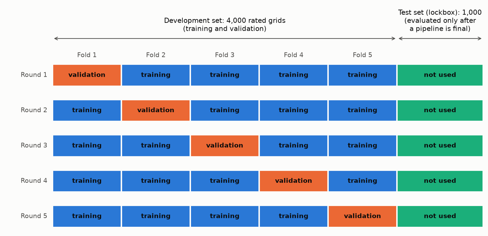
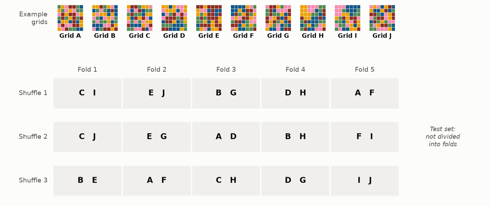
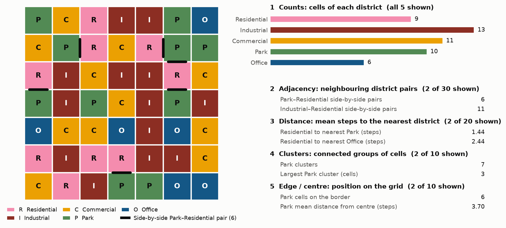
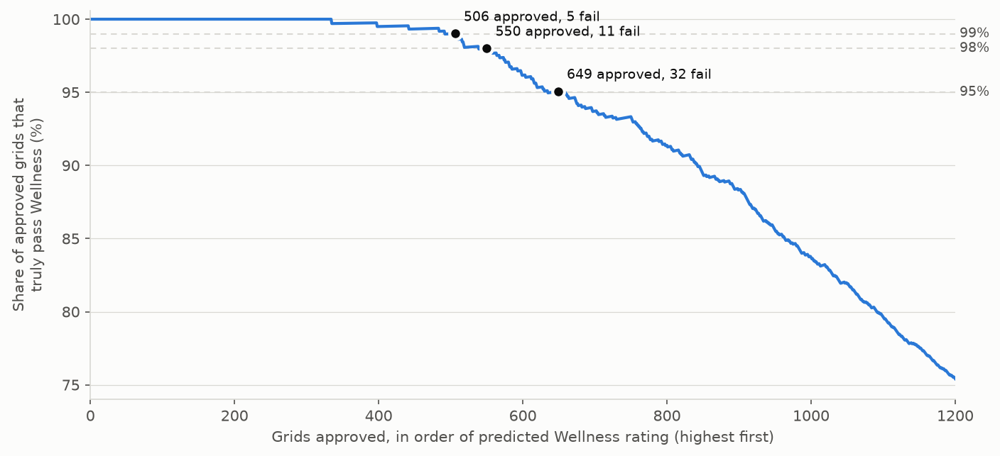

# Stage 1: How models are evaluated

Part of the 2.156 CP2 docs. The [README](../README.md) has the goal and the code flow;
[`decisions.md`](decisions.md) has every decision with its evidence.

The four advisors can't be asked to rate new grids. So we train a *surrogate model* per advisor on
its example ratings, and let the models judge designs. This page sets how those models are scored,
so that no score is flattered by *leakage* (evaluation grids influencing training or model choice).

**Terms.**
- *Grid:* a 7 × 7 layout; each cell is one of five districts.
- *Rating:* an advisor's score for a grid, 0–1. A grid *passes* an advisor at 0.75 or more, and is
  *valid* if it passes all four.
- *Approve:* a model approves a grid when its predicted rating is at or above the advisor's
  *cut-off*. *Precision* is the share of approved grids that truly pass ("Model scorecard").
- *Stages:* 1, this protocol; 2, models; 3, designing grids; 4, picking and submitting 100.

## Data

| Code | District | Letter in figures |
|---|---|---|
| 0 | Residential | R |
| 1 | Industrial | I |
| 2 | Commercial | C |
| 3 | Park | P |
| 4 | Office | O |

- 500,000 grids. Each advisor rated 5,000. The other 480,289 are unrated; later stages start
  designs from them.
- Only 286 grids are rated by two or more advisors (283 by two, 3 by three), none by all four.
  Pairs of advisors share 36–64 grids, about the 50 that independent random samples would give.
- Each advisor's 5,000 are treated as a random sample of the 500,000. In the 26 October audit,
  rated and unrated grids had matching district mixes, and a classifier could not tell them apart
  (`decisions.md`).

*Source: `python validity.py --data` (reads which grids are rated, never a rating);
`tests/test_protocol.py` checks the counts.*

## Data split

Each advisor's 5,000 rated grids are split the same way (Figure 1):
- **Test set ("lockbox"), 1,000 grids.** Never used for training or for choosing anything. It holds
  all 286 grids rated by two or more advisors.
  - Only `validity.open_lockbox()` returns these ratings. It needs a confirmation and a fully
    committed repository, and logs each opening in [`lockbox_log.md`](lockbox_log.md).
  - It was opened once, on 4 November, to grade the final models (the final exam).
  - The normal loader, `validity.load_dev()`, returns test-set ratings as missing (NaN).
- **Development set, 4,000 grids.** Used for training and for every comparison, by five-fold
  cross-validation: deal the grids into five *folds* of 800, train on four, check on the fifth
  (the *validation fold*), and repeat so that each fold is checked once.

**Figure 1. The split for one advisor.** Each row is one round of cross-validation: a fresh model
trains on the four blue folds and is checked on the orange one. The test set (green) is used in no
round.

**Shuffle procedure.** Which grid lands in which fold is random. One such dealing is a *shuffle*,
fixed by a *seed* so it can be repeated. We use three shuffles (seeds 0, 1, 2; Figure 2), so every
model is trained and checked in 15 rounds.
- Each reported number is the mean over the three shuffles. The scorecard also prints the three
  values, which show how much a result moves from the random dealing alone.
- The *R² noise threshold* is the spread (standard deviation) of R² over the 15 validation folds:
  0.002–0.009 for the primary model. It measures how fold difficulty varies, not the uncertainty of
  a difference between two models, so Stage 2 compares models fold by fold instead
  ([`stage2_models.md`](stage2_models.md)).

**Figure 2. Three shuffles, shown with ten example grids (A–J) instead of 4,000.** Each row deals
the same ten grids into the five folds of Figure 1 in a different way. In shuffle 1, round 1 checks
grids C and I (fold 1) and trains on the other eight; in shuffle 2, round 1 checks C and J.

**Out-of-fold predictions.** In each round, the model predicts the grids in its validation fold,
which it never saw: these are *out-of-fold predictions*. After five rounds, every development grid
has one per shuffle; in Figure 2's shuffle 1, C and I get theirs in round 1. Every scorecard number
uses only these. A prediction for a grid the model trained on is too good, because the model has
seen the answer.

**Why a separate test set.** Picking the best of several options by validation score also picks up
luck. After many such choices, validation scores overstate accuracy (*selection bias*). The test
set, opened once after all choices, gives a nearly unbiased check. Its limits:
- Four early analyses saw test-set ratings before the split was fixed. `decisions.md`
  (25 October) lists them and why their influence is small.
- At Stage 1's approval rates, only about 130–210 of each advisor's 1,000 are approved, so a test-set precision is uncertain by
  about one percentage point. It catches only large drops.
- It measures accuracy on grids like the dataset's, not on designs.

## Features

A model's inputs are its *features*. Two kinds:
- **One-hot cells (245):** one 0/1 indicator per cell and district (49 × 5). They describe the
  whole grid, but say nothing about which cells are neighbours; the model must learn that.
- **Engineered features (75):** spatial measures designed from the advisors' stated priorities,
  such as green-space access and commuting (Figure 3):

| Group | Measure | Features |
|---|---|---|
| Counts | Cells of each district | 5 |
| Adjacency | Neighbouring cell pairs for each pair of districts (15 pairs), side-by-side and diagonal counted separately | 30 |
| Distance | For each ordered pair of different districts: mean steps (up, down, left, right) from a cell of the first to the nearest cell of the second | 20 |
| Clusters | Number of connected groups of each district, and the size of the largest | 10 |
| Edge / centre | The district's cells on the border; mean steps from the centre cell | 10 |

A missing district gets distance 13 (one more than the farthest possible, 12) and centre distance
0; its count of 0 tells it apart.

**Figure 3. One grid and 13 of its 75 engineered features.** Left: grid A of Figure 2 (dataset
grid 12). The black bars mark its six side-by-side Park–Residential pairs, which one adjacency
feature counts. Right: all five counts and two examples from each other group; each group repeats
for every district or pair of districts. `analysis.ipynb` lists all 75 for any grid.

**Orientation.** The 75 features don't change when a grid is rotated or mirrored. Stage 2's
position test found that position matters for Wellness, Tax and Business, but not Transportation.
So rotated copies are used neither in training for those three nor in any submission, and
Wellness's final model adds the one-hot cells (`decisions.md`, 31 October and 1 November).

## Models

Four models: two types, each given each kind of input.
- **Ridge regression:** a weighted sum of the inputs. A penalty keeps the weights small, to limit
  *overfitting* (learning quirks of the training grids that don't hold for other grids).
  scikit-learn.
- **GBM (gradient-boosted trees):** several hundred small decision trees, each asking yes/no
  questions such as "more than 8 Park cells?" and each fitted to the errors of the trees before it.
  It can capture thresholds and interactions. LightGBM.

Code names: `ridge_onehot`, `ridge_engineered`, `gbm_onehot`, `gbm_engineered`. The *primary
model*, chosen in planning (25 October), is `gbm_engineered`.

## Model scorecard

The comparison metric is the **approval count at 98% precision** (Figure 4):
1. Sort the 4,000 development grids by predicted rating, highest first.
2. Approve them one at a time down the list.
3. Stop at the last point where at least 98% of the approved grids truly pass. The number approved
   is the *approval count*; the predicted rating there is the *cut-off*.

More approvals at the same precision means more passing grids that the model can be trusted on.
The cut-off is set on the same grids it is scored on, so the count is slightly optimistic: it ranks
models, but doesn't promise the same on new grids.

**Figure 4. Measuring the approval count (Wellness, primary model, shuffle 1).** Moving right
approves grids with lower predicted ratings; the curve is the share of the approved grids that
truly pass. The dots mark where it last stays at 99%, 98% and 95%: 506, 550 and 649 grids approved,
of which 5, 11 and 32 fail.

**Risk of approving more grids.** From 98% to 95% precision, Figure 4 approves 99 more grids but adds 21
failures: about one in five of the added grids fails. A failed grid scores nothing. In the starter
notebook's example, removing one grid cuts the score by 0.0064 (less in a set of similar grids).

**Why 98%.**
- A grid counts only if it passes all four advisors. At 98% each, 0.98⁴ ≈ 92% of the grids that
  all four approve are valid, if the models' errors are unrelated. 92% is also near the worst case:
  if each model wrongly approves at most 2 in 100, at most 8 in 100 fail.
- 98% is an average over all approved grids. Grids just above the cut-off fail far more often, and
  a design search pushes grids to just above it. So designs need a *cushion* above the cut-off. The
  scoreboard later showed that a cushion of 0.06 was enough (README, Figure 2).
- Only 11–17 failures lie behind each advisor's 98%, so it is uncertain by about a point either
  way: 4–13 invalid grids per 100, not exactly 8.

| Precision per advisor | Valid for all four (precision⁴) | Invalid per 100 | Approved: Wellness | Tax | Transportation | Business |
|---|---|---|---|---|---|---|
| 90% | 66% | 34 | 844 | 1,008 | 959 | 1,026 |
| 95% | 81% | 19 | 668 | 916 | 840 | 931 |
| **98%** | **92%** | **8** | **534** | **828** | **744** | **836** |
| 99% | 96% | 4 | 473 | 757 | 711 | 800 |

*Source: `python validity.py` (its last table), primary model; approvals are three-shuffle means.*

**R².** 1 minus the ratio of mean squared error to the variance of the true ratings: 1 is perfect, 0
is no better than always predicting the average. It is a general check, not the main metric,
because it counts errors far from 0.75 that never change whether a grid passes.

**Results.**

| Approval count at 98% precision: mean [per shuffle] | Wellness | Tax | Transportation | Business |
|---|---|---|---|---|
| Ridge regression on one-hot cells | 67 [68/66/67] | 611 [612/608/612] | 0 [0/0/0] | 40 [4/62/55] |
| GBM on one-hot cells | 76 [31/78/118] | 543 [562/512/556] | 5 [4/7/5] | 82 [104/74/69] |
| Ridge regression on engineered features | 242 [261/241/223] | 817 [814/822/815] | 19 [1/30/27] | 182 [185/185/177] |
| **GBM on engineered features** | **534 [550/523/528]** | **828 [842/815/828]** | **744 [745/750/738]** | **836 [847/814/847]** |
| *Cut-off (primary model)* | *0.824* | *0.772* | *0.775* | *0.765* |
| *Share of truly passing grids approved (primary model)* | *52%* | *86%* | *74%* | *84%* |

| R², mean of three shuffles ± noise threshold | Wellness | Tax | Transportation | Business |
|---|---|---|---|---|
| Ridge regression on one-hot cells | 0.481 ± 0.027 | 0.757 ± 0.024 | 0.121 ± 0.029 | 0.481 ± 0.036 |
| GBM on one-hot cells | 0.502 ± 0.025 | 0.704 ± 0.015 | 0.293 ± 0.026 | 0.495 ± 0.026 |
| Ridge regression on engineered features | 0.695 ± 0.024 | 0.871 ± 0.016 | 0.650 ± 0.020 | 0.603 ± 0.022 |
| **GBM on engineered features** | **0.888 ± 0.009** | **0.967 ± 0.002** | **0.935 ± 0.005** | **0.969 ± 0.004** |

*Source: `python validity.py`. Bold: the primary model.*

1. **Features matter more than model type.** For Transportation, the GBM goes from R² 0.293 on
   one-hot cells to 0.935 on engineered features. Changing only one of the two (model or input)
   approves 5 or 19 grids, against 744 with both.
2. **Wellness is the limit.** The primary model approves 52% of the truly passing Wellness grids,
   against 74–86% for the others. It became Stage 2's first target.
3. **The primary model leads for every advisor.** For three advisors the lead is far beyond the
   shuffle-to-shuffle spread (at most 33 approvals). For Tax, Ridge on engineered features is
   within that spread on approvals (817 against 828) but far behind on R² (0.871 against 0.967).
4. **Stage 1 reproduces the planning runs:** every R² is within 0.01 of its planning value (largest
   gap 0.0052).

`analysis.ipynb` shows these results as charts (its Figures 5–7).

## What can and cannot be checked

- **Each model is checked only on its own advisor's grids.** A rated grid carries one advisor's
  rating, apart from the 286 in the test set.
- **Validity is predicted, not checked.** All four models predict, and a grid is *predicted valid*
  only if all four approve. Grid A (dataset grid 12), rated only by Wellness:

| Advisor | Predicted | Cut-off | Approved? | True rating |
|---|---|---|---|---|
| Wellness | 0.840 | 0.824 | Yes | 0.867 |
| Tax | 0.203 | 0.772 | No | — |
| Transportation | 0.800 | 0.775 | Yes | — |
| Business | 0.641 | 0.765 | No | — |

*Source: `python validity.py --grid 12`. The Wellness prediction is out of fold; the others come
from models trained on each advisor's whole development set. Grid A is predicted invalid.*

- **A model's record carries over to grids its advisor never rated,** because both come from the
  same random pool ("Data").
- **It does not carry over to designs.** A design search keeps the grids the models rate highly,
  which gathers up the models' over-predictions. Hence the cushion, and the outside checks: the
  fooling check and the scoreboard ([`architecture.md`](architecture.md), "Checks").
- **Do the models fail on the same grids?** Before the final exam, `test_set.py --expect` measured
  each model's precision on grids another advisor's model also approves. On the test set, 10 of the
  286 co-rated grids were approved by every rater's model, and all 10 passed (`decisions.md`,
  4 November): too few to measure, but no counter-example.
- **The scoreboard** is the only check of all four advisors at once. It reports one score. The
  number of failed grids is worked out from the gap to the score if all had passed (README,
  Figure 2).

## How the code fits together

Stage 1's commands (the whole flow is in the [README](../README.md#code-flow)):

| Command | What it does | Writes |
|---|---|---|
| `./setup_data.sh` | Fetches the course repository at the commit pinned in `course_commit.txt` | `data/cp2-repo/` |
| `python validity.py` | The scorecard: out-of-fold predictions for 4 models × 4 advisors, then the tables above | `data/cache/oof/` |
| `python validity.py --grid 12` | Grid A's table | nothing |
| `python validity.py --data` | The counts under "Data" | nothing |
| `python make_figures.py --stage 1` | Figures 1–4 (`--stage 0`: the README's Figure 1) | `docs/figures/` |
| `analysis.ipynb` | The same results, interactively, plus Figures 5–7 | — |

`python validity.py` runs `load_dev()`, then for each model and advisor `out_of_fold()` (features,
then the 15 rounds from `cv_splits()`), then `score()` (approval count and cut-off from
`approved_at()`, R², noise threshold), then prints the tables.

**Saved predictions.** `out_of_fold()` saves its predictions under a fingerprint (`cache_key()`) of
the grids, inputs, ratings, model settings, folds, seeds, library versions and course commit.
Changing any of these recomputes them (about 8 minutes; a few seconds when saved). Not covered:
code edits that leave every setting unchanged (`make_model()`, the training loop, the inside of
`cv_splits()`, the augmentation helpers). After such an edit, run `python validity.py --no-cache`.

## Automated tests

`pytest` runs locally and on GitHub after every push. Each test guards against an error that would
spoil results without a crash:

| File | Checks |
|---|---|
| `test_features.py` | The 75 features match a slow, independent version, and don't change under all 8 rotations and mirrors |
| `test_protocol.py` | The test-set list matches a stored fingerprint; test and development grids don't overlap, even as rotated copies; `load_dev()` hides test ratings; every out-of-fold prediction comes from a fresh model that never saw that grid; the test set opens only when confirmed and committed, and logs itself; saved predictions are reused only on a matching fingerprint; the "Data" counts |
| `test_metrics.py` | Approval count and cut-off behave as defined, including ties |
| `test_scoring.py` | `scoring.diversity` equals the course's `diversity_score`; the submission check rejects bad formats and duplicate grids |
| `test_palette.py`, `test_pin.py` | District colours stay distinguishable, including with colour blindness; the course data matches the pin |

**The tests catch real faults.** `python tests/fault_injection.py` breaks the code on purpose, in
memory, and confirms that the matching test fails. Stage 1's seven faults: a changed test-set seed;
augmenting before the split; a corrupted feature; training on the grids being predicted; with
augmentation, training on every grid; one model reused across rounds; an orientation helper that
stops rotating. Stage 2 adds four.

## Course-repository updates

The graded `diversity_score` lives in the course repository, so updates are detected but never
applied automatically.
- `./setup_data.sh --check` compares the pin with the course's latest commit (exit code 1: it has
  moved). A GitHub workflow runs it daily once the workflow is on `main`.
- `./setup_data.sh --update` adopts the latest commit and rewrites the pin, printing any change to
  `utils_public.py` in full.
- If `data/cp2-repo/` is missing, the starter notebook downloads the latest commit instead;
  `tests/test_pin.py` fails until `./setup_data.sh` restores the pin.
