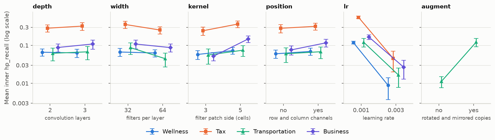

# Stage 2: Models

Part of the 2.156 CP2 docs. Terms (folds, shuffles, out-of-fold predictions, cut-off, precision,
approval count) are defined in [`stage1_evaluation.md`](stage1_evaluation.md). The rules were
recorded before Stage 2 began ([`decisions.md`](decisions.md), 28 October).

*Status (8 Nov): done. Six recipe slots ran from 31 Oct to 4 Nov, and the models were final when
the test set opened on 4 Nov. The upgraded models of 7 Nov (`upgraded.py`) did not go through this
harness; `decisions.md` records that deviation.*

## What Stage 2 does

Stage 1's best model approves 534 Wellness grids at 98% precision, against 744–836 for the other
advisors, so Wellness limits how many grids pass all four (`python validity.py`). Stage 2 tries to
do better by *searching*: trying many options (feature groups, model settings, neural networks) and
keeping the best.

- A *recipe* (procedure) says what may vary, how the options are tried, and then refits the winner
  on all the data it was given. Stage 1's GBM is a recipe with nothing to search.
- The *incumbent* is the recipe in use for an advisor; it starts as Stage 1's GBM. A *challenger*
  is a recipe being compared with it.
- At most six recipes per advisor may compete, the incumbent included.

## Why searching needs a second layer of folds

**Searching flatters the winner.** The same GBM approves 550, 523 or 528 Wellness grids depending
only on the shuffle. Try 50 equally good options and keep the best, and you have kept the luckiest:
its score overstates how it will do on new grids.

**The fix is nested cross-validation** (Figure 1). Stage 1's folds become the *outer* folds, and the
search runs only inside each outer training set, on *inner* folds of its own.

```text
ONE ADVISOR · 4,000 development-set grids
│
│  OUTER: Stage 1's folds, 3 shuffles × 5 folds = 15 rounds. In each round:
│
│  ┌── outer training set: 3,200 grids with ratings (all the recipe may see) ─────┐
│  │                                                                              │
│  │   INNER: 4 folds of these 3,200 (train on 2,400, check on 800, four times)   │
│  │     for each option: train on 2,400 → predict the other 800 → inner score    │
│  │     keep the option with the best inner score                                │
│  │   refit the chosen option on all 3,200                                       │
│  │                                                                              │
│  └────────────────────────────────────┬─────────────────────────────────────────┘
│                                       │ predicts
│                                       ▼
│     outer validation fold: 800 grids (ratings used only afterwards, to score)
│
▼
After 15 rounds, every grid has 3 predictions (one per shuffle), each from a run
whose search never saw that grid. These give the recipe's score.
```

**Figure 1. Nested cross-validation for one advisor.** The outer rounds are Stage 1's, so every
recipe is scored on the same 15 folds as Stage 1's GBM and the two can be compared fold by fold.
The search may choose differently in each round, so the score measures the recipe, not one model.
The final model comes from running the recipe once more, on all 4,000 grids.

## The inner score: hp_recall

*Recall* at a precision level is the share of the truly passing grids that a model approves while
keeping that precision. Stage 1's GBM approves 52% of the truly passing Wellness grids at 98%.
*hp_recall* averages recall at 96%, 97%, 98% and 99% precision, so it doesn't hinge on two or three
grids. Two steps use the smoother mean squared error instead: dropping a hopeless option early, and
adding feature groups one at a time.

## How a challenger replaces the incumbent

Both must hold, on the outer predictions:
1. **It wins fold by fold.** A one-sided paired t-test on the 15 per-fold hp_recall differences
   must give t ≥ 1.761. The t is *corrected* (Nadeau–Bengio), because the 15 rounds reuse the same
   grids; this widens the uncertainty about 2.2 times.
2. **It wins by a useful margin:** at least 3% more approvals at 98% precision. For Wellness that
   is 533.67 × 1.03 = 549.7.

## What the harness enforces

`search.py` runs Figure 1 and refuses to cut corners:
- It scores only registered recipes, at most six per advisor.
- It runs only with everything committed and records the commit, so git shows that each recipe
  existed before its results.
- Stage 1's GBM, run through it with nothing to search, gives exactly Stage 1's predictions
  (534 / 828 / 744 / 836 approvals).
- A spy test fails if an outer-validation grid reaches any inner or final fit.
- It never reads Stage 1's saved predictions, which would leak inside a round.

A search over *T* options costs 4*T* + 1 GBM fits per outer round, with 15 rounds per advisor. Ten
single-core fits side by side beat one fit across ten cores, with identical predictions. The CNN
search took 7 h 12 min (`decisions.md`, 31 Oct).

## Results

| Advisor | Stage 1 GBM | Adopted recipe | Approved at 98% |
|---|---|---|---|
| Wellness | 533.7 | GBM on the 75 features + one-hot cells (1 Nov) | 575.3 (+7.8%) |
| Tax | 828.3 | none beat the incumbent | 828.3 |
| Transportation | 744.3 | mean of its GBM recipes (4 Nov) | 770.0 (+3.4%) |
| Business | 836.0 | GBM + up to 3 extra feature groups (1 Nov) | 910.0 (+8.9%) |

*Approvals are three-shuffle means of outer predictions (`python search.py --compare NAME`;
`decisions.md`, 1 and 4 Nov).* Rejected: the CNN for all four advisors (28–86% fewer approvals),
and the tuned GBM for all four (Transportation +4.7% but t 1.73, just short).



**Figure 2. What the CNN search learned about its settings.** A CNN (convolutional neural network)
reads the grid directly instead of the 75 features. Each panel is one setting the search tried at
two values. Each point is the mean inner hp_recall over all trials at that value, with a rough 95%
interval; one line per advisor. The y-axis is logarithmic.
- **Learning rate matters most.** Every advisor scored far higher at 0.001 than at 0.003 (Tax 0.549
  against 0.045).
- **Rotated copies** were tried only for Transportation, the one advisor indifferent to position,
  and helped it a lot (0.122 against 0.011).
- **Still far behind:** even with the best settings, the CNN approved 28–86% fewer grids than the
  GBMs. The best rate, 0.001, sat at the edge of the range, which hints at under-training; but 10
  of the 60 saved refits had collapsed to one constant output (found 4 Nov), which also drags the
  scores down. Regenerate with `python make_figures.py --stage 2`.
